# Advanced examples

Each example below is self-contained. Circuit and measurement diagrams use
`plotq(...)` as dependency-free text by default. To reproduce the graphical
figures, install and load `PyPlot`, select `backend=:pyplot`, or run
`docs/generate_figures.jl` from the repository root. The latter also produces the
scientific plots. Random samples and circuit realizations vary between runs.

## 9) Classical shadow experiment

[`shadow`](@ref) samples local X, Y, or Z measurement bases and averages their
inverse-measurement estimators. This implementation constructs a full
`2^N × 2^N` matrix, so use it for small systems.

```@example shadows
using BlueTangle, LinearAlgebra
ops = [Op("H", 1), Op("CX", 1, 2), Op("CX", 2, 3)]
circuit = compile(ops)
rho_estimate = shadow(circuit, 1000)
ZZ_estimate = correlation(rho_estimate, "Z,Z", [1, 2])
@assert isapprox(real(tr(rho_estimate)), 1; atol=1e-10)
(estimated_ZZ=ZZ_estimate, exact_ZZ=1.0)
```

A finite-sample shadow estimator can have negative eigenvalues and observable
estimates outside physical bounds. It can estimate linear observables, but it is
not necessarily a physical density matrix. Its eigenvalues cannot be treated as
probabilities or inserted into an entropy formula without a separately justified
reconstruction procedure.

## 10) Entanglement Entropy and Spectrum

For a pure global state, the reduced-state entropy measures entanglement across
a cut. A Bell pair gives a check with known answer: its reduced eigenvalues are
`[1/2, 1/2]`, so the entropy is `log(2)` **nats**.

```@example entropy
using BlueTangle
ops = [Op("H", 1), Op("CX", 1, 2)]
state = apply(ops, zero_state(2))
rho = state * state'
S_vector, spectrum = entanglement_entropy(state)
S_density = entanglement_entropy(rho; spectrum_bool=false)
psi = apply(ops, zero_state(N_MPS(2)))
S_mps = entanglement_entropy(psi, 1)
@assert isapprox(S_vector, log(2); atol=1e-12)
@assert S_vector ≈ S_density ≈ S_mps
(entropy_nats=S_vector, entanglement_spectrum=spectrum)
```

The spectrum contains `-log(p)` for nonzero reduced-state eigenvalues `p`.
Vector and density-matrix inputs use the last `floor(N/2)` qubits as one side.
The MPS default cuts after the first `floor(N/2)` sites; specify the cut with
`entanglement_entropy(psi, b)`. Those defaults differ for odd `N`.
Vector/density calls return `(entropy, spectrum)` by default; MPS returns the
entropy alone unless `spectrum_bool=true`.

For a mixed global density matrix, reduced entropy includes statistical mixing
and is not an entanglement measure by itself. For example, the separable mixture
of `|00⟩` and `|11⟩` also has reduced entropy `log(2)`.

## 11) Time Evolution of Hamiltonians

Consider the open-chain Ising Hamiltonian

```math
H=-J\sum_{i=1}^{N-1}X_iX_{i+1}-h\sum_{i=1}^{N}Z_i.
```

`hamiltonian_exp` approximates `exp(-im*time*H)` by first-order product steps.
Compare against exact evolution at the same time, using exact outcome
probabilities so that shot noise does not obscure the Trotter error.

```@example trotter
using BlueTangle, LinearAlgebra
N = 4
terms = [-1.0, "X,X", -0.8, "Z"]
time = 0.6
H = hamiltonian(N, terms)
exact_state = evolve(zero_state(N), H, time)
trotter_ops = hamiltonian_exp(N, time, terms; dt=0.05)
trotter_circuit = compile(trotter_ops)
trotter_state = to_state(trotter_circuit)
trotter_measurement = measure(trotter_state; label="Trotter dt=0.05")
exact_measurement = measure(exact_state; label="Exact")
finer_state = to_state(compile(hamiltonian_exp(N, time, terms; dt=0.025)))
@assert norm(finer_state-exact_state) < norm(trotter_state-exact_state)
@assert isapprox(norm(trotter_state), 1; atol=1e-12)
(fidelity=abs2(dot(exact_state, trotter_state)),
 error_dt=norm(trotter_state-exact_state), error_half_dt=norm(finer_state-exact_state))
```

The first 16 scheduled layers are shown below; this is only a preview of the
full evolution circuit.

```julia
using PyPlot
plotq(trotter_circuit.layers[1:16]; backend=:pyplot, fold=6)
plotq([trotter_measurement, exact_measurement]; backend=:pyplot)
```

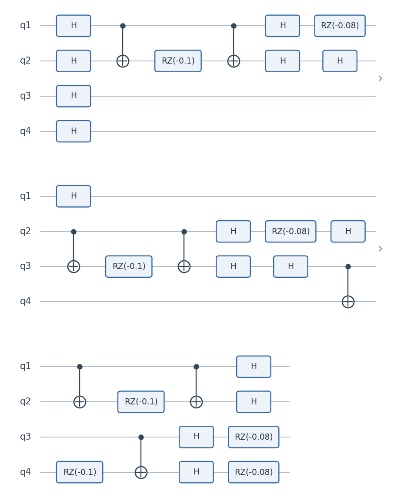

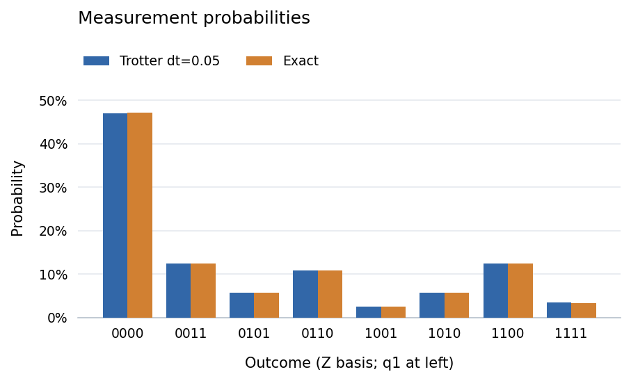

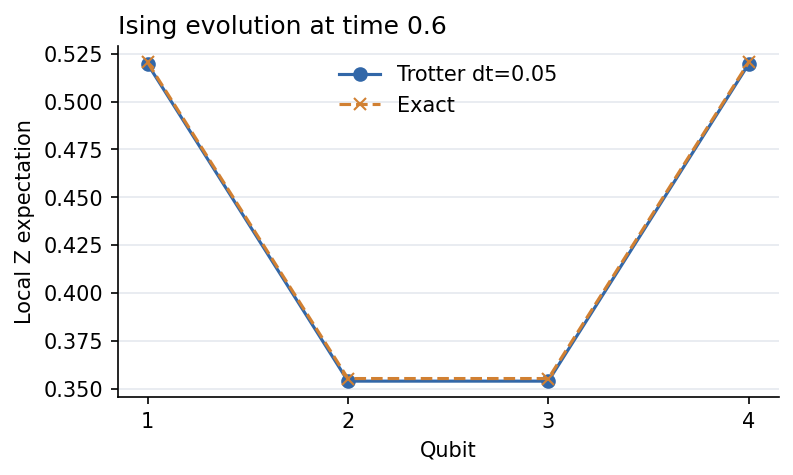

Halving `dt` improves this example. In general, check convergence at your chosen
Hamiltonian and evolution time. Increasing circuit depth reduces discretization
error while increasing simulated gate-noise exposure when a noise model is used.

## 12) Error Mitigation: Pauli Twirling

Pauli frames can randomize the structure of coherent gate errors. They preserve
the ideal controlled gate, but only an average over frames produces the twirled
channel. They do not guarantee a better answer for every circuit or observable.

```@example twirling
using BlueTangle
rotation_error = 0.2 # radians on each member of the two-qubit channel
noise = NoiseModel(false, Noise2("rot_z", rotation_error))
twirl_ops = [Op("H", 1), Op("H", 2), Op("CX", 1, 2),
             Op("CX", 2, 1), Op("H", 1), Op("H", 2)]
ideal_circuit = compile(twirl_ops, Options(circuit_name="Ideal"))
noisy_circuit = compile(twirl_ops, Options(circuit_name="Coherent noise", noise=noise))
twirled_circuit = compile(twirl_ops,
    Options(circuit_name="Randomized frames", noise=noise, twirl=true))
twirl_measurements = [measure(circuit, 4000) for circuit in
                      (ideal_circuit, noisy_circuit, twirled_circuit)]
@assert all(m -> isapprox(sum(m.sample), 1; atol=1e-12), twirl_measurements)
[m.expect for m in twirl_measurements]
```

The `twirl=true` sampling path chooses frames on each shot. Here single-qubit
frame gates are ideal because the model only adds two-qubit noise. Giving them
single-qubit noise changes the comparison and can offset the benefit.

```julia
plotq(noisy_circuit; backend=:pyplot)
plotq(twirl_measurements; backend=:pyplot)
```

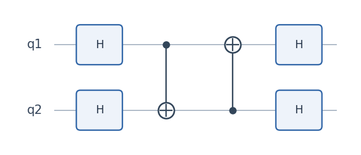

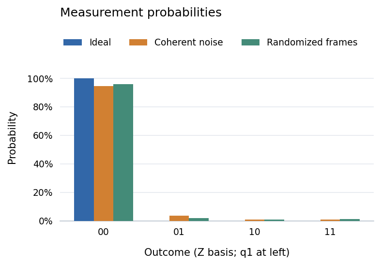

## 13) Manual noise amplification and extrapolation

For a CNOT, three consecutive copies implement the same ideal gate because
`CNOT^2 = I`. Replacing each CNOT by `2pairs + 1` copies increases the number of
noisy two-qubit operations while preserving the ideal circuit. Copy and fold the
operation list explicitly before each measurement.

```@example manual_folding
using BlueTangle
base_ops = [Op("H", 1), Op("CX", 1, 2)]
noise = NoiseModel(false, Noise2("depolarizing", 0.01))
scales = [1, 3, 5]
measurements = Measurement[]
for pairs in 0:2
    folded = copy(base_ops)
    cnot_amplifier!(folded, pairs)
    @assert to_state(compile(folded)) ≈ to_state(compile(base_ops))
    circuit = compile(folded, Options(noise=noise))
    push!(measurements, measure(circuit, 2000; backend=:density_matrix))
end
values = [correlation(m, [1, 2]) for m in measurements]
intercept, slope, se_intercept, se_slope = linear_fit(scales, values)
(scales=scales, sampled_ZZ=values, extrapolated_ZZ=intercept)
```

The scale labels count CNOT applications. They describe a uniform noise scale
only under the chosen stationary gate-noise model; other error sources require
separate treatment. The linear intercept is an estimate under that model, and
its regression error is not a complete uncertainty estimate. It can lie outside
the physical interval or be less accurate than the unmitigated value.

[`op_amplifier!`](@ref) repeats **every** operation. Repeating a general rotation
changes the ideal circuit; use [`cnot_amplifier!`](@ref) for this example. There is
no automatic noise-scaling option or special measurement mode.

## 14) Error Mitigation: Measurement Errors

For independent classical readout errors, a known response matrix maps true
basis probabilities to observed ones. BlueTangle can apply its inverse to the
sampled distribution. This example uses a 10% bit flip immediately before
readout; the response is assumed known, without calibration uncertainty.

```@example readout
using BlueTangle
readout_ops = [Op("H", 1), Op("CX", 1, 2)]
readout_error = Noise1("bit_flip", 0.1)
readout_circuits = [
    compile(readout_ops, Options(circuit_name="Ideal")),
    compile(readout_ops, Options(circuit_name="Readout error", readout_noise=readout_error)),
    compile(readout_ops, Options(circuit_name="Inverse corrected",
        readout_noise=readout_error, measurement_mitigate=true)),
]
readout_measurements = [measure(circuit, 4000; backend=:density_matrix)
                       for circuit in readout_circuits]
@assert all(m -> isapprox(sum(m.sample), 1; atol=1e-12), readout_measurements)
[correlation(m, [1, 2]) for m in readout_measurements]
```

```julia
plotq(readout_measurements; backend=:pyplot)
```

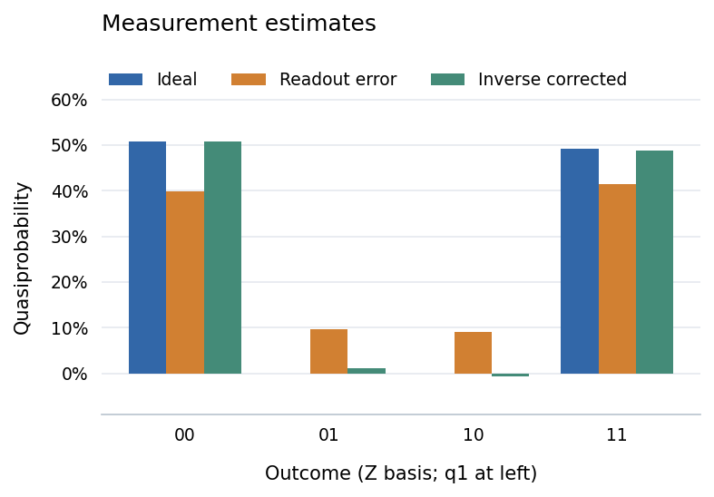

Inverse correction amplifies sampling error and can produce signed estimates
and expectation values outside their physical bounds at finite shot counts.
It does not undo gate errors or unknown/correlated readout errors. A singular
response, such as a 50% bit flip, cannot be inverted.

## 15) Layout and Nonlocal Swaps during Circuit Compilation

`Layout` takes a **site-occupancy grid**, not an adjacency matrix. Positive cells
are physical qubits; horizontally and vertically adjacent occupied cells are
neighbors. Qubits are numbered in Julia's column-major order. This grid has five
qubits, connected as `2—1—3—4—5`:

```@example layout
using BlueTangle, SparseArrays
layout = Layout(sparse([1 1 1; 1 0 1]))
layout.geometry
```

The compiler routes nonlocal two-qubit gates with swaps and restores the original
wire ordering afterwards. A local gate needs no swaps:

```@example layout
nonlocal_ops = [Op("H", 1), Op("CX", 1, 5)]
local_ops = [Op("H", 1), Op("CX", 1, 3), Op("I", 5)]
controlled_ops = [Op("H", 1), Op("X", 5; control=1)]
nonlocal_circuit = compile(nonlocal_ops; layout=layout)
local_circuit = compile(local_ops; layout=layout)
controlled_circuit = compile(controlled_ops; layout=layout)
@assert to_state(nonlocal_circuit) ≈ apply(nonlocal_ops, zero_state(5))
@assert to_state(controlled_circuit) ≈ apply(controlled_ops, zero_state(5))
@assert nonlocal_circuit.stats.swap_count > 0
@assert local_circuit.stats.swap_count == 0
@assert controlled_circuit.stats.swap_count > 0
plotq(controlled_circuit)
nothing # hide
```

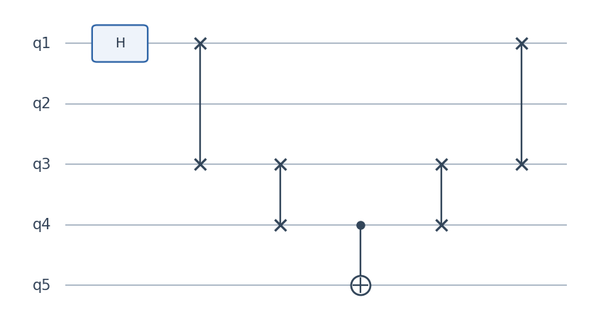

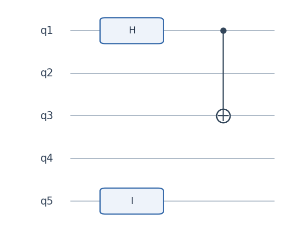


Routing these operations is not a complete hardware transpiler. Arbitrary
whole-register callbacks and general multi-controlled operations are not
decomposed into a device's native gate set. `Layout(...; noisy_swap=true)` can
include inserted swaps in the circuit's gate-noise model.

## 16) Hadamard Test

An ancilla prepared and measured with Hadamards gives

```math
\langle Z_{\mathrm{anc}}\rangle=\operatorname{Re}\langle\psi|U|\psi\rangle.
```

Here `U=Z` and the system is `|1⟩`, so the answer is `-1`. Qubit 1 is the ancilla;
qubit 2 is the system. There are exactly two ancilla Hadamards.

```@example hadamard
using BlueTangle
hadamard_ops = [Op("X", 2), Op("H", 1), Op("Z", 2; control=1), Op("H", 1)]
state = apply(hadamard_ops, zero_state(2))
ancilla_Z = expect(state, "Z")[1]
@assert isapprox(ancilla_Z, -1; atol=1e-12)
ancilla_Z
```

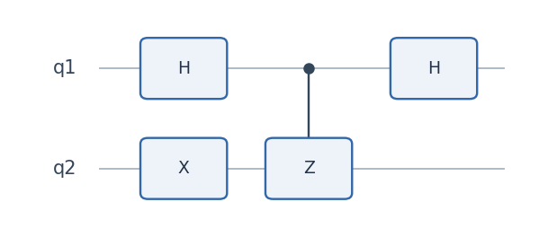

For finite-shot estimation use `prob(state, shots, 1)` and subtract the returned
probabilities `p0-p1`. The exact calculation above separates the identity being
tested from sampling noise.

## 17) Swap Test

A controlled swap between two input states gives
`2Pr(ancilla=0)-1 = |⟨psi|phi⟩|^2`. Take `psi=|0⟩` and `phi=|+⟩`; their squared
overlap is `1/2`.

```@example swap_test
using BlueTangle
swap_ops = [Op("H", 3), Op("H", 1), Op("SWAP", 2, 3; control=1), Op("H", 1)]
state = apply(swap_ops, zero_state(3))
overlap_squared = expect(state, "Z")[1]
@assert isapprox(overlap_squared, 0.5; atol=1e-12)
(p_ancilla_zero=(1+overlap_squared)/2, overlap_squared=overlap_squared)
```

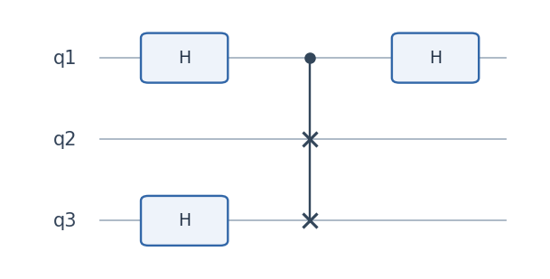

Qubit 1 is the ancilla, and qubits 2 and 3 hold the two inputs. The measurement
reveals the squared magnitude of the overlap, not its complex phase.

## 18) Variational Quantum Eigensolver

VQE, trainable and custom gates, ansatz generators, and their API reference now
live in the dedicated [QML section](qml.md).

## 19) Measurement-induced entanglement transition using MPS

This example illustrates the finite-circuit competition behind the topic in
its title. It does **not** locate or establish a measurement-induced transition.
Unitary gates can build entanglement, while local measurements remove it on
average along individual pure-state trajectories.

First check the MPS implementation against a dense vector for a **unitary**
circuit. Independently executing a circuit with measurements generally selects
different outcomes, so its two final pure states should not be compared directly.

```@example monitored_mps
using BlueTangle, LinearAlgebra, Statistics
unitary_ops = random_ops(6, 4)
dense = apply(unitary_ops, zero_state(6))
psi = apply(unitary_ops, zero_state(N_MPS(6)); cutoff=0.0, maxdim=8)
@assert isapprox(abs2(dot(dense, to_state(psi))), 1; atol=1e-10)
illustrative_ops = random_ops(6, 3; measure_prob=0.2, measure_basis=["MZ"])
plotq(illustrative_ops)
nothing # hide
```

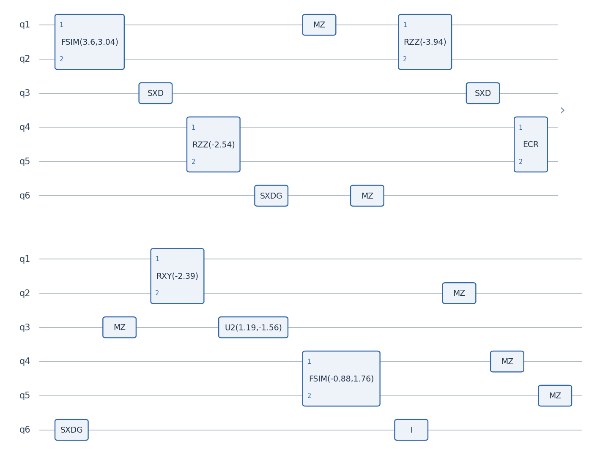

Now generate an independent circuit and Born-rule measurement trajectory for
each repetition. After each random unitary layer, each site is measured in Z
with probability `p`. Measure the entropy **after the final measurement layer**.
At `p=1`, that final layer leaves a product state, giving a useful zero-entropy
check.

`random_ops` uses its discrete mixed family of one- and adjacent two-qubit gates
to fill disjoint layers; this is not a Haar-random brickwork ensemble. The
generator and measurement schedule are part of the specified model.

```@example monitored_mps
sizes = [4, 6]
probabilities = [0.0, 0.25, 0.5, 0.75, 1.0]
depth = 8
trajectories = 24
entropy_samples = Dict{Tuple{Int,Float64},Vector{Float64}}()
for N in sizes, p in probabilities
    samples = Float64[]
    for repetition in 1:trajectories
        ops = random_ops(N, depth; measure_prob=p, measure_basis=["MZ"])
        trajectory_state = apply(ops, zero_state(N_MPS(N)); cutoff=0.0, maxdim=2^(N÷2))
        push!(samples, entanglement_entropy(trajectory_state, N÷2))
    end
    @assert all(S -> -1e-10 <= S <= (N÷2)*log(2) + 1e-10, samples)
    entropy_samples[N, p] = samples
end
@assert all(N -> maximum(abs, entropy_samples[N, 1.0]) < 1e-10, sizes)
[(N=N, p=p, mean_entropy=mean(entropy_samples[N,p]),
  standard_error=std(entropy_samples[N,p])/sqrt(trajectories))
 for N in sizes for p in probabilities]
```

For these small even `N`, `maxdim=2^(N÷2)` permits the full Schmidt rank at every
cut, and `cutoff=0` avoids deliberate truncation. This is a small exact-capacity
MPS demonstration, not evidence of efficiency at large `N`.

```julia
using PyPlot
fig, ax = subplots()
for N in sizes
    means = [mean(entropy_samples[N,p]) for p in probabilities]
    errors = [std(entropy_samples[N,p])/sqrt(trajectories) for p in probabilities]
    ax.errorbar(probabilities, means; yerr=errors, marker="o", capsize=3, label="N=$N")
end
ax.set_xlabel("Z-measurement probability per site per layer")
ax.set_ylabel("Mean half-chain trajectory entropy (nats)")
ax.legend()
fig.tight_layout()
```

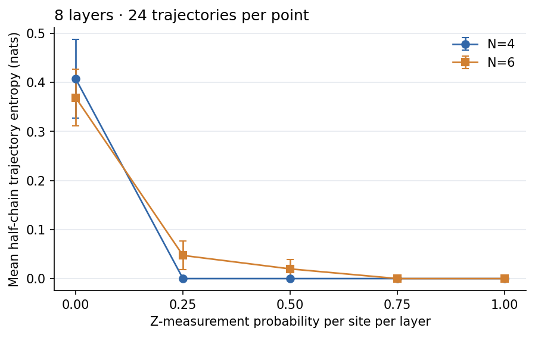

Each error bar is one estimated standard error across 24 independent circuit
and outcome realizations. The plotted quantity is the **mean of trajectory
entropies**, not the entropy of an averaged density matrix. The latter includes
classical uncertainty over outcomes and answers a different question.

These two small sizes and eight layers only show a finite-depth trend. Studying
a transition would require larger sizes, checks of depth/steady-state convergence,
many more trajectories, and convergence with MPS truncation settings before any
finite-size scaling analysis.
