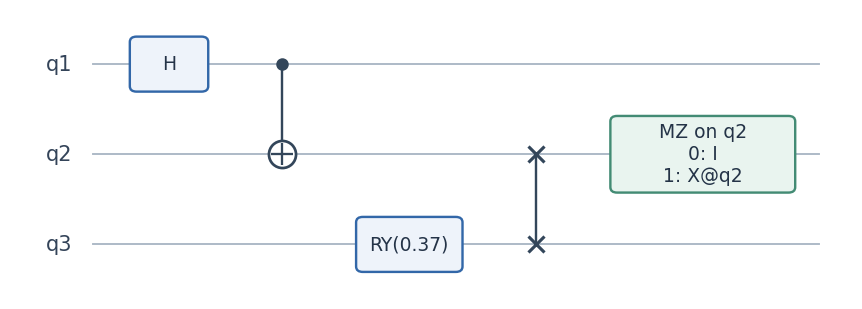
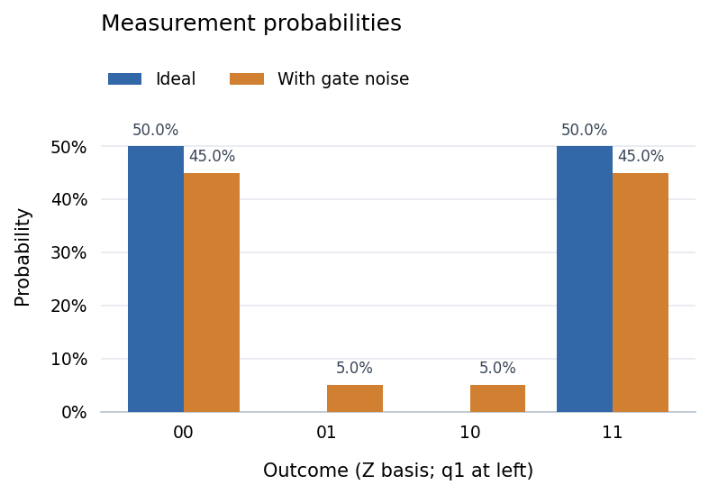
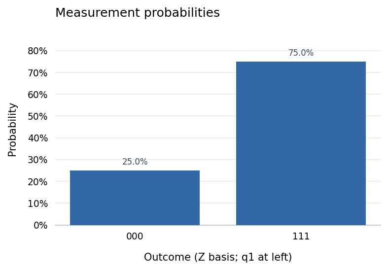
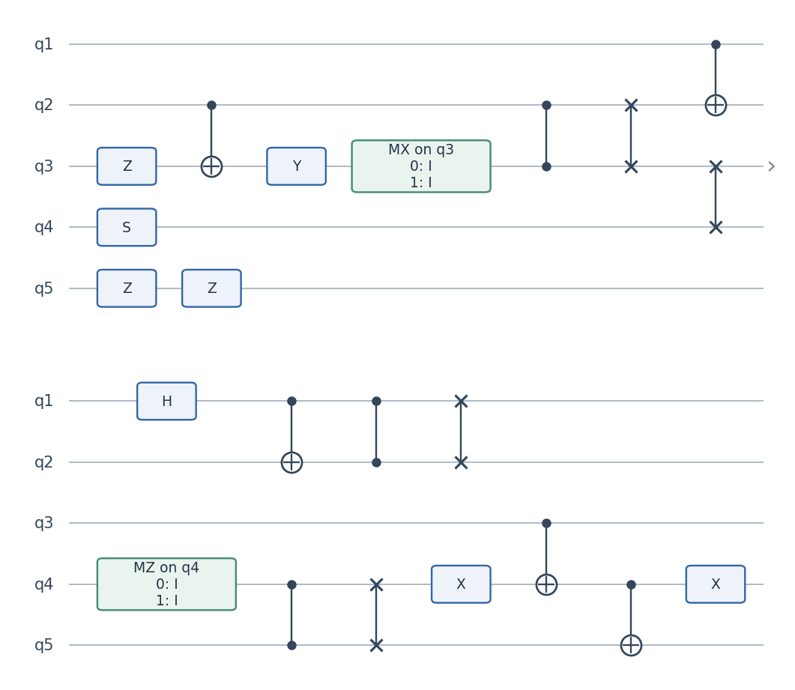

# Examples

## 1) GHZ Circuit

A Hadamard followed by two CNOTs prepares
`(|000⟩ + |111⟩)/sqrt(2)`. Apply the operations directly to the initial state:

```@example ghz
using BlueTangle
ops = [Op("H", 1), Op("CX", 1, 2), Op("CX", 2, 3)]
state = apply(zero_state(get_N(ops)), ops)
@assert correlation(state, "Z,Z", [1, 2]) ≈ 1
@assert correlation(state, "X,X,X", [1, 2, 3]) ≈ 1
get_stats(ops)
```

## 2) Measurement and Correlations

A finite-shot measurement estimates computational-basis probabilities. An exact
state or density matrix can evaluate other observables directly. These examples
continue from the GHZ circuit above.

```@example ghz
measurement = measure(ops, 1000)
rho = apply(to_rho(zero_state(3)), ops)
exact_measurement = measure(rho) # exact basis probabilities, no shots
@assert correlation(measurement, [1, 2]) ≈ 1
@assert correlation(rho, "X,X,X", [1, 2, 3]) ≈ 1
(sampled_Z=measurement.expect, exact_Z=expect(rho, "Z"),
 exact_ZZ=correlation(rho, "Z,Z", [1, 2]))
```

`measurement.bitstr` contains integer basis labels and `measurement.sample`
their estimated probabilities. Qubit 1 is the most significant bit. A single Z
measurement distribution cannot determine arbitrary X/Y correlations; change the
measurement basis or use the simulated state when it is available.

## 3) Plot circuits and measurement results

`plotq` prints a boxed text diagram by default, without a plotting package.
Qubit 1 is at the top; controls, targets, and measurements share the wires.

```@example plotting_text
using BlueTangle
feedback_ops = QuantumOps[
    Op("H", 1), Op("CX", 1, 2), Op("RY(0.37)", 3),
    Op("SWAP", 2, 3), Op("MZ", 2; if1="X")
]
plotq(feedback_ops)
nothing # hide
```

`plotqt` is also available as a direct text renderer. For graphics, install
PyPlot once (`using Pkg; Pkg.add("PyPlot")`), load it, and select it explicitly:

```julia
using PyPlot
fig = plotq(feedback_ops; backend=:pyplot)
savefigure(fig, "circuit_feedback.png")
```



Measurement plots also default to text. The following comparison uses exact
probabilities of density matrices, so it isolates gate noise from sampling error.

```@example plotting_text
bell_ops = [Op("H", 1), Op("CX", 1, 2)]
rho0 = zero_state(2) * zero_state(2)'
ideal = measure(apply(rho0, bell_ops); label="Ideal")
noisy = measure(apply(rho0, bell_ops; noise=NoiseModel("depolarizing", 0.08));
                label="With gate noise")
plotq([ideal, noisy], ["Ideal", "With gate noise"])
nothing # hide
```

```julia
fig = plotq([ideal, noisy], ["Ideal", "With gate noise"]; backend=:pyplot)
savefigure(fig, "measurement_comparison.png")
```



Bitstring labels put qubit 1 on the left. Use `rep=:int` for integer labels.
Large outcome sets show the largest `max_outcomes=32` entries and group the rest
as `Other`. `fold` wraps circuit diagrams: it measures characters for text and
columns for graphics. `savefigure(path)` saves the current graphical figure.

## 4) Noise Models and Circuits

Gate noise is specified separately for one-qubit and two-qubit gates:

```@example noise_models
using BlueTangle, LinearAlgebra
n1 = Noise1("bit_flip", 0.001)
n2 = Noise2("depolarizing", 0.01)
noise = NoiseModel(n1, n2)
ops = [Op("H", 1), Op("CX", 1, 2), Op("CX", 2, 3)]
rho = apply(to_rho(zero_state(3)), ops; noise=noise)
@assert isapprox(real(tr(rho)), 1; atol=1e-12)
@assert eigmin(Hermitian(Matrix(rho))) >= -1e-12
correlation(rho, "Z,Z", [1, 2])
```

`NoiseModel("bit_flip", 0.001, "depolarizing", 0.01)` is equivalent.
`Noise2(model, p)` is the tensor product of the corresponding one-qubit channels:
for depolarizing noise with `p=0.01`, each operand has a 1% nonidentity Pauli error,
so the probability of at least one operand error is `1-(1-p)^2`.

| Model | Parameter meaning |
|:--|:--|
| `amplitude_damping` | Excited-state decay probability `p` |
| `phase_damping` | Off-diagonal entries acquire a factor `sqrt(1-p)` |
| `phase_flip`, `bit_flip`, `bit_phase_flip` | Apply Z, X, or Y with probability `p` |
| `depolarizing` | Apply X, Y, or Z with total probability `p`, each equally likely |
| `rot_X`, `rot_Y`, `rot_Z`, `rot_P` | Coherent rotation/phase angle in radians |

Statevectors and MPS sample one Kraus branch; density matrices sum all branches.
A channel applied before final readout has a separate `readout_noise` option.

## 5) Custom noise models and gates

Built-in matrices are available as `gate.X`, `gate.CNOT`, or `gate.T`.
Parameterized matrices use `gates("RX(0.3)")`, `_RX(0.3)`, or the public functions
`U1`, `U2`, and `U3`. A custom local matrix uses `Op("my gate", matrix, qubit)`.

For a custom channel provide Kraus operators satisfying
`sum(K' * K for K in kraus) ≈ I`:

```@example custom_channel
using BlueTangle
p = 0.3
kraus = [sqrt(1-p)*gate.I, sqrt(p)*gate.Z]
@assert is_valid_quantum_channel(kraus)
channel = custom_noise(1, "my phase flip", kraus)
state = plus_state(1)
rho = state * state'
noisy_rho = apply(rho, Op(channel, 1))
@assert noisy_rho ≈ (1-p)*rho + p*gate.Z*rho*gate.Z
```

The constructor validates dimensions and the trace-preserving condition. Use
`custom_noise(2, name, kraus)` for two-qubit Kraus matrices.

## 6) Conditional Mid-Measurements

A conditional measurement applies a branch chosen by its recorded bit. In this
example, measure qubit 1 in X: outcome 0 applies Z, and outcome 1 applies H.
Both `Op("MX", 1; if0="Z", if1="H")` and `ifOp("MX", 1, "Z", "H")` express this.

```@example conditional
using BlueTangle
mid_ops = QuantumOps[Op("X", 1), Op("MX", 1; if0="Z", if1="H"),
                     Op("CX", 1, 2), Op("CX", 2, 3)]
mid_rho = apply(to_rho(zero_state(3)), mid_ops)
mid_measurement = measure(mid_rho; label="Conditional circuit")
@assert real(mid_rho[1,1]) ≈ 0.25
@assert real(mid_rho[8,8]) ≈ 0.75
mid_measurement.sample
```

The first X gate prepares `|100⟩`. Measuring qubit 1 in X gives `|+⟩` or `|−⟩`
with equal probability. For outcome 0, Z maps `|+⟩` to `|−⟩`, and the CNOTs make
`(|000⟩-|111⟩)/sqrt(2)`. For outcome 1, H maps `|−⟩` to `|1⟩`, and the CNOTs
make `|111⟩`, up to an irrelevant global phase. The final unconditioned Z
probabilities are therefore 25% `000` and 75% `111`.



Track a particular trajectory and its record explicitly:

```@example conditional
trajectory, record = apply(zero_state(3), mid_ops; track_measurements=true)
@assert length(record) == 1
@assert only(record) in (0, 1)
record
```

## 7) Reset Operation on a Qubit

Reset measures a qubit in Z and applies X when necessary to return it to zero.
It removes the qubit's entanglement; it cannot reset half of a Bell pair while
preserving the original pure two-qubit state.

```@example reset
using BlueTangle, LinearAlgebra
bell = apply(zero_state(2), [Op("H", 1), Op("CX", 1, 2)])
reset_rho = apply(bell*bell', Op("RES", 1))
@assert reset_rho ≈ Diagonal([0.5, 0.5, 0, 0])
trajectory = apply(bell, Op("RES", 1))
@assert expect(trajectory, "Z")[1] ≈ 1
reset_rho
```

The density matrix is the equal mixture of `|00⟩` and `|01⟩`. One pure-state
trajectory selects one of those two states.

## 8) Random Quantum Circuits

`random_clifford(N, len)` generates `len` Clifford gates; a measurement can be
inserted after each gate with the chosen probability. Two-qubit gates use
adjacent sites. Here is one realization with X/Z measurements:

```@example random_circuits
using BlueTangle
random_ops_example = random_clifford(5, 20; measure_prob=0.2, measure_basis=["MX", "MZ"])
plotq(random_ops_example)
nothing # hide
```



`random_ops(N, depth)` instead builds `depth` disjoint unitary layers, choosing
from its mixed gate family and then independently measuring each site with
probability `measure_prob` after each layer. It is not a Haar-random circuit
ensemble, and its generation depth need not equal the rescheduled circuit depth.
For a small ensemble experiment see [example 19](advanced.md#19%29-Measurement-induced-entanglement-transition-using-MPS).

## Operations through one entry point

Use `Op` to construct each kind of operation:

| Construction | Meaning |
|:--|:--|
| `Op("H", 1)` | Local gate |
| `Op("MZ", 1; if0="I", if1="X")` | Measurement with a branch chosen by the recorded bit |
| `Op(Noise1("bit_flip", 0.1), 1)` | Kraus noise channel |
| `Op("block", [Op("H", 1), Op("CX", 1, 2)])` | Named operation sequence on the whole register |
| `Op("full", matrix)` | Matrix acting on the whole register |
| `Op("transform", f)` | Function taking and returning the whole state |

The objects remain distinct internally (`Op`, `ifOp`, `OpQC`, and `OpF`) because
unitary gates, selective measurements, noise channels, and complete-register
transformations have different semantics. Their existing constructors remain
available. A parameterized **local** gate includes its qubit index, such as
`Op("rotation", theta -> _RX(theta), 1)`; this is different from a function of the
whole state.

Circuit simplification cancels matching ideal gate identities. Applying a noise
model to the shorter circuit then changes its noise exposure; simplification is
not an equivalence of noisy channels.

```@example operation_entry
using BlueTangle
block = Op("bell block", [Op("H", 1), Op("CX", 1, 2)])
state = apply(zero_state(2), block)
@assert correlation(state, "Z,Z", [1, 2]) ≈ 1
conditional_reset = Op("MZ", 1; if0="I", if1="X")
reset_state, record = apply(one_state(1), conditional_reset; track_measurements=true)
@assert record == [1]
@assert reset_state ≈ zero_state(1)
```

## Ensemble evolution and a measurement trajectory

Discarding a measurement outcome destroys coherence between its outcome sectors.
Conditioning on one observed outcome instead gives a normalized conditional
state. These are different density matrices:

```@example ensemble_trajectory
using BlueTangle, LinearAlgebra
state = plus_state(1)
rho = state * state'
ensemble = apply(rho, Op("MZ", 1))
conditional, record = apply(rho, Op("MZ", 1); track_measurements=true)

@assert ensemble ≈ [0.5 0; 0 0.5]
@assert only(record) in (0, 1)
@assert isapprox(real(tr(conditional^2)), 1; atol=1e-12)
(ensemble_purity=real(tr(ensemble^2)), conditional_purity=real(tr(conditional^2)))
```

Density-matrix `apply` sums unobserved noise and measurement
branches. With `track_measurements=true`, measurement outcomes are sampled and
returned alongside the conditional state. Statevectors and MPS states follow a
single trajectory through stochastic operations.

Use `measure(ops, shots; backend=:statevector)`, `:density_matrix`, or
`:tensor` to sample final outcomes. `run(ops, shots; backend=...)` returns
explicit mid-circuit records. On MPS, `measure(psi)` uses 1000 shots by default;
exact probability enumeration with `measure(psi, -1)` is limited to 16 qubits
unless the lower-level `sample_exact` limit is explicitly changed.

## Optional PhasePoly backend

After installing PhasePoly separately, load it to activate the adapter:

```julia
using Pkg
Pkg.add(url="https://github.com/aydindeger/PhasePoly.jl") # optional, once
using BlueTangle
import PhasePoly

ops = [Op("H", 1), Op("H", 2), Op("CZ", 1, 2), Op("T", 1)]
compact = phasepoly(ops)
expect(compact, "X")                     # one expectation per physical qubit
correlation(compact, "X,Z", [1, 2])      # native compact Pauli calculation
amplitude(compact, [0, 1])               # amplitude of |01⟩
state = to_state(compact)                # explicitly materialize the sparse state
@assert state ≈ apply(zero_state(2), ops)
```

The adapter preserves BlueTangle's physical qubit labels, statevector ordering,
and global phase. It supports a restricted noiseless gate family: affine
permutations, supported diagonal phases, and Hadamards. Unsupported gates and
noise raise errors. Leading and trailing Hadamard layers use efficient native
paths; interior Hadamards require branching, and level-4 phases can also have
exponential cost. Native Pauli queries avoid statevector materialization in the
single-branch case. See `?phasepoly` for phase-angle grids and cost guards.

## Operation lists and migration

A circuit is represented by its operations. The `compile`, `quantum_circuit`,
and `Circuit` APIs have been removed. For an existing state, write
`apply(state, ops)`; the earlier `apply(ops, state)` spelling still works.

| Earlier expression | Operation-list expression |
|:--|:--|
| `to_state(compile(ops))` | `apply(zero_state(get_N(ops)), ops)` |
| `to_rho(compile(ops))` | `apply(to_rho(zero_state(get_N(ops))), ops)` |
| `measure(compile(ops, options), shots)` | `measure(ops, shots; options=options)` |
| `run(compile(ops), shots)` | `run(ops, shots)` |
| `shadow(compile(ops), shots)` | `shadow(ops, shots)` |
| `compile(ops; layout=layout)` | `route(ops, layout)` |
| `circuit.stats` / `circuit.layers` | `get_stats(ops)` / `get_layers(ops)` |
| `plotq(circuit)` / `to_qasm(circuit)` | `plotq(ops)` / `to_qasm(ops)` |

No routing or rescheduling happens during ordinary execution. `route` returns
operations with explicit SWAPs for the chosen layout; `get_layers` remains
available for inspection and plotting. Sampling functions also accept an
optional `layout` keyword. Use `N=...` with `measure`, `run`, or `shadow` to retain
idle qubits beyond those mentioned by the operation list.

Use `measure(ops, shots; options=Options(noise=noise))` for independent noisy
preparations. `measure(apply(state, ops; noise=noise), shots)` instead samples
the one resulting state: for a vector or MPS, this represents one noise
trajectory and generally gives a different experiment. Density-matrix
execution sums noise branches before sampling. Twirling, basis choices, readout
noise, and readout mitigation continue to use `Options`.

`save_data(ops, measurement, other; options=options, path="results.ser")` stores
the operations, execution options, measurement, and optional additional data.
Retrieve them from `load_data(path).ops`, `.options`, `.measurement`, and `.other`.
To migrate an existing serialized object containing the old `Circuit` type,
load it with the earlier package version and export its operations and settings
before upgrading; Julia cannot deserialize that removed type in this version.
