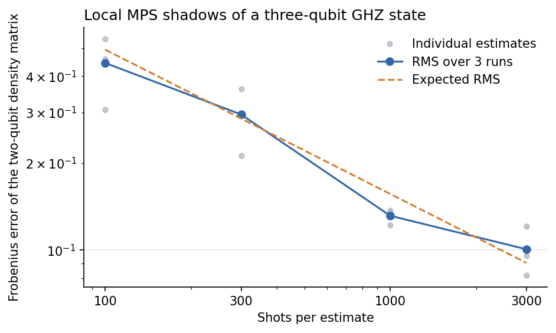
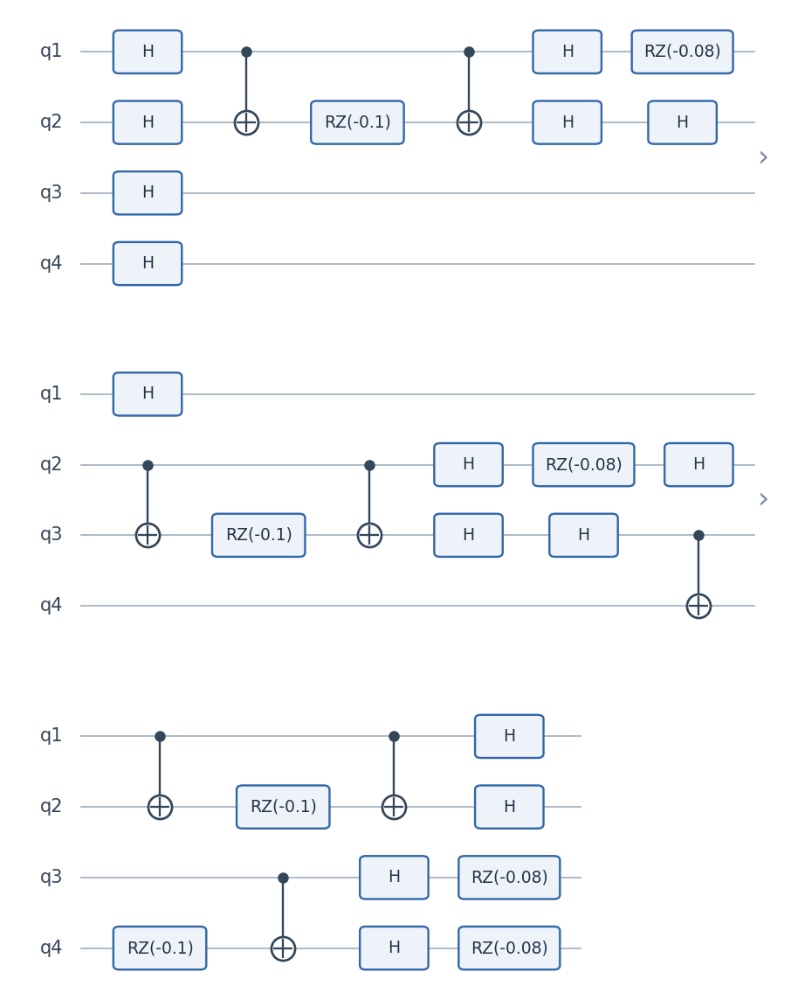
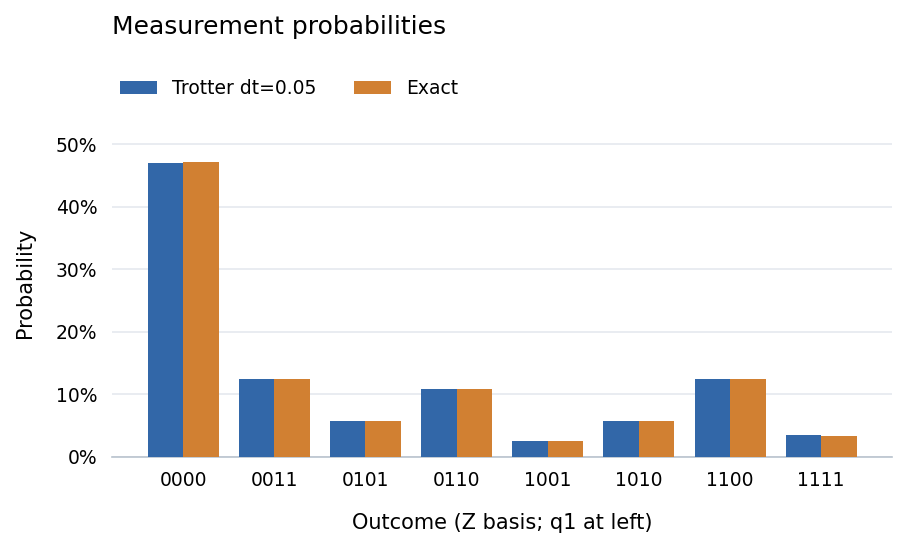
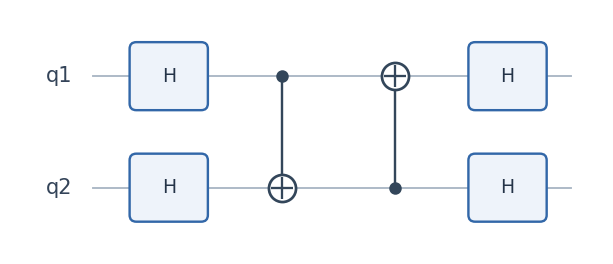
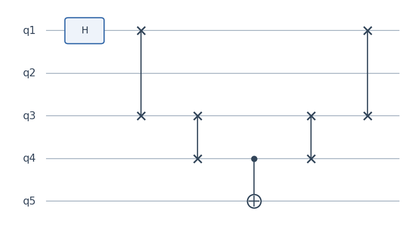
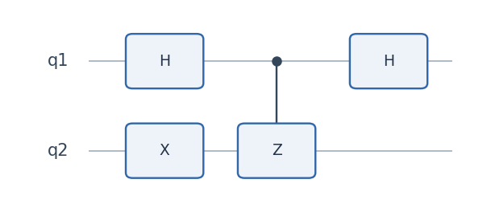
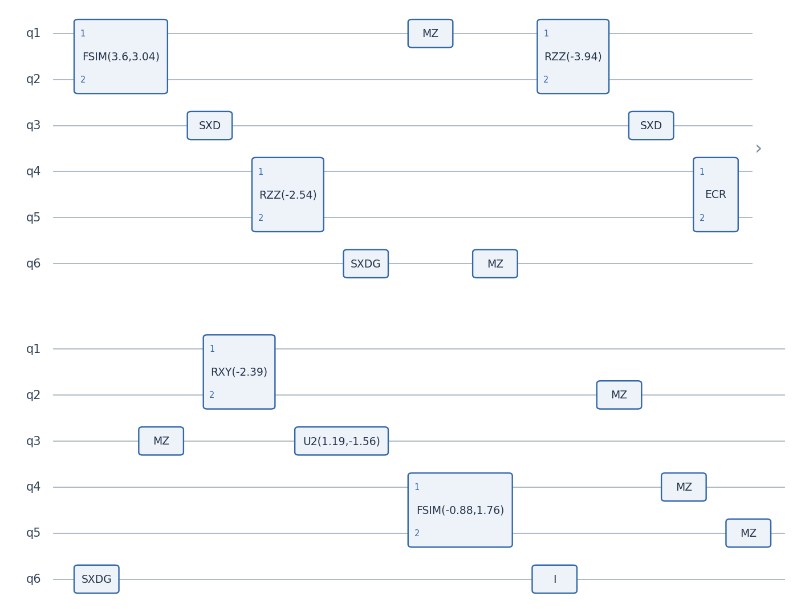
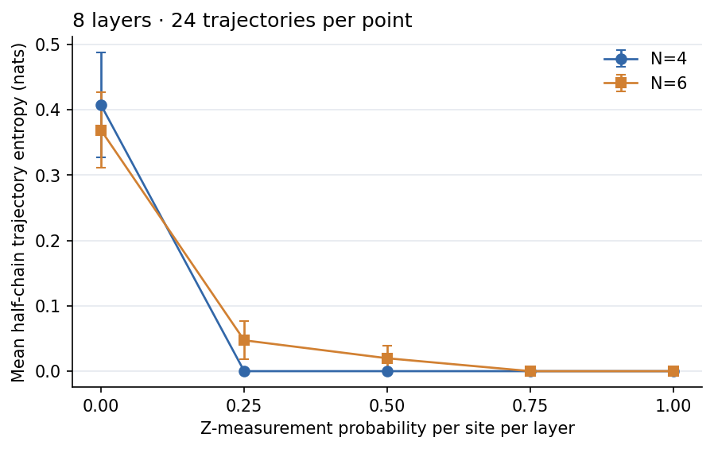

# Examples

`plotq(...)` displays circuit and measurement diagrams as text by default.
For graphical figures, install and load `PyPlot`, then select
`backend=:pyplot`. The script `docs/generate_figures.jl` reproduces the figures
and scientific plots on this page when run from the repository root. Random
samples and circuit realizations vary between runs.

## 1) GHZ Circuit

A Hadamard followed by two CNOTs prepares
`(|000⟩ + |111⟩)/sqrt(2)`. Apply the operations directly to the initial state:

```@example ghz
using BlueTangle
ops = [Op("H", 1), Op("CX", 1, 2), Op("CX", 2, 3)]
state = apply(zero_state(get_N(ops)), ops)
@assert correlation(state, "Z,Z", [1, 2]) ≈ 1
@assert correlation(state, "X,X,X", [1, 2, 3]) ≈ 1
get_stats(ops)
```

## 2) Measurement and Correlations

A finite-shot measurement estimates computational-basis probabilities.
Observables can also be evaluated directly from a simulated statevector or
density matrix. These examples
continue from the GHZ circuit above.

```@example ghz
measurement = measure(ops, 1000)
rho = apply(to_rho(zero_state(3)), ops)
exact_measurement = measure(rho) # exact basis probabilities, no shots
@assert correlation(measurement, [1, 2]) ≈ 1
@assert correlation(rho, "X,X,X", [1, 2, 3]) ≈ 1
(sampled_Z=measurement.expect, exact_Z=expect(rho, "Z"),
 exact_ZZ=correlation(rho, "Z,Z", [1, 2]))
```

`measurement.bitstr` contains integer basis labels and `measurement.sample`
their estimated probabilities. Qubit 1 is the most significant bit. X and Y
correlations require measurements in the corresponding bases, or direct
evaluation from the simulated state when it is available.

## 3) Plot circuits and measurement results

In a circuit diagram, qubit 1 is at the top. Controls, targets, and measurements
appear on their corresponding wires.

```@example plotting_text
using BlueTangle
feedback_ops = QuantumOps[
    Op("H", 1), Op("CX", 1, 2), Op("RY(0.37)", 3),
    Op("SWAP", 2, 3), Op("MZ", 2; if1="X")
]
plotq(feedback_ops)
nothing # hide
```

`plotqt` renders text diagrams directly. For graphics, install
PyPlot once (`using Pkg; Pkg.add("PyPlot")`), load it, and select it explicitly:

```julia
using PyPlot
fig = plotq(feedback_ops; backend=:pyplot)
savefigure(fig, "circuit_feedback.png")
```


Measurement plots also default to text. The following comparison uses exact
probabilities of density matrices, so it isolates gate noise from sampling error.

```@example plotting_text
bell_ops = [Op("H", 1), Op("CX", 1, 2)]
rho0 = zero_state(2) * zero_state(2)'
ideal = measure(apply(rho0, bell_ops); label="Ideal")
noisy = measure(apply(rho0, bell_ops; noise=NoiseModel("depolarizing", 0.08));
                label="With gate noise")
plotq([ideal, noisy], ["Ideal", "With gate noise"])
nothing # hide
```

```julia
fig = plotq([ideal, noisy], ["Ideal", "With gate noise"]; backend=:pyplot)
savefigure(fig, "measurement_comparison.png")
```


Bitstring labels put qubit 1 on the left. Use `rep=:int` for integer labels.
Large outcome sets show the largest `max_outcomes=32` entries and group the rest
as `Other`. `fold` wraps circuit diagrams: it measures characters for text and
columns for graphics. `savefigure(path)` saves the current graphical figure.

## 4) Noise Models and Circuits

Gate noise is specified separately for one-qubit and two-qubit gates:

```@example noise_models
using BlueTangle, LinearAlgebra
n1 = Noise1("bit_flip", 0.001)
n2 = Noise2("depolarizing", 0.01)
noise = NoiseModel(n1, n2)
ops = [Op("H", 1), Op("CX", 1, 2), Op("CX", 2, 3)]
rho = apply(to_rho(zero_state(3)), ops; noise=noise)
@assert isapprox(real(tr(rho)), 1; atol=1e-12)
@assert eigmin(Hermitian(Matrix(rho))) >= -1e-12
correlation(rho, "Z,Z", [1, 2])
```

`NoiseModel("bit_flip", 0.001, "depolarizing", 0.01)` is equivalent.
`Noise2(model, p)` is the tensor product of the corresponding one-qubit channels:
for depolarizing noise with `p=0.01`, each operand has a 1% nonidentity Pauli error,
so the probability of at least one operand error is `1-(1-p)^2`.

| Model | Parameter meaning |
|:--|:--|
| `amplitude_damping` | Excited-state decay probability `p` |
| `phase_damping` | Off-diagonal entries acquire a factor `sqrt(1-p)` |
| `phase_flip`, `bit_flip`, `bit_phase_flip` | Apply Z, X, or Y with probability `p` |
| `depolarizing` | Apply X, Y, or Z with total probability `p`, each equally likely |
| `rot_X`, `rot_Y`, `rot_Z`, `rot_P` | Coherent rotation/phase angle in radians |

Statevectors and MPS sample one Kraus branch; density matrices sum all branches.
A channel applied before final readout has a separate `readout_noise` option.

## 5) Custom noise models and gates

Built-in matrices are available as `gate.X`, `gate.CNOT`, or `gate.T`.
Parameterized matrices use `gates("RX(0.3)")`, `_RX(0.3)`, or the public functions
`U1`, `U2`, and `U3`. A custom local matrix uses `Op("my gate", matrix, qubit)`.

For a custom channel, provide Kraus operators satisfying
`sum(K' * K for K in kraus) ≈ I`:

```@example custom_channel
using BlueTangle
p = 0.3
kraus = [sqrt(1-p)*gate.I, sqrt(p)*gate.Z]
@assert is_valid_quantum_channel(kraus)
channel = custom_noise(1, "my phase flip", kraus)
state = plus_state(1)
rho = state * state'
noisy_rho = apply(rho, Op(channel, 1))
@assert noisy_rho ≈ (1-p)*rho + p*gate.Z*rho*gate.Z
```

The constructor validates dimensions and the trace-preserving condition. Use
`custom_noise(2, name, kraus)` for two-qubit Kraus matrices.

## [6) Mid-circuit measurement and feedback](@id conditional-measurements)

A mid-circuit measurement changes the state before later gates run. Use
`Op("MZ", q)`, `Op("MX", q)`, or `Op("MY", q)` to measure qubit `q` in a Pauli
basis. The recorded bit labels the eigenvalue: **0 means +1, and 1 means −1**.
Thus X outcomes correspond to `|+⟩` and `|−⟩`, and Y outcomes to
`(|0⟩ + im|1⟩)/sqrt(2)` and `(|0⟩ - im|1⟩)/sqrt(2)`. The postmeasurement state
is expressed in the original computational basis.

For a measured Pauli operator `P`, the projectors and outcome probabilities are

```math
P_b=\frac{I+(-1)^bP}{2},\qquad
p_b=\operatorname{tr}(P_b\rho),\qquad
\rho_b=\frac{P_b\rho P_b}{p_b}.
```

Here the projector acts on the measured qubit and as the identity elsewhere.
A sampled outcome uses the normalized state `rho_b`; ignoring the outcome
gives `sum(P_b * rho * P_b for b in (0,1))`. Statevectors and MPS represent one
sampled trajectory even when its record is not requested. Density matrices can
represent either result; see [ensemble versus trajectory](@ref measurement-backends).
Use normalized input states for trajectory simulation.

```@example pauli_measurement
using BlueTangle
plus_y = ComplexF64[1, im] / sqrt(2)
after, bits = run(plus_y, Op("MY", 1))
@assert bits == [0]
@assert after * after' ≈ plus_y * plus_y'
(record=bits, state=after)
```

`Op("MR", q)` chooses X, Y, or Z uniformly on each trajectory. Its record
contains the outcome bit but omits the chosen basis. To retain the basis,
choose and record it explicitly when constructing the operation list. `apply(rho, ops)`
averages over all three bases and their outcomes.

### Apply gates conditioned on the outcome

A conditional measurement applies a branch chosen by its recorded bit. In this
example, measure qubit 1 in X: outcome 0 applies Z, and outcome 1 applies H.
Both `Op("MX", 1; if0="Z", if1="H")` and `ifOp("MX", 1, "Z", "H")` express this.

```@example conditional
using BlueTangle
mid_ops = QuantumOps[Op("X", 1), Op("MX", 1; if0="Z", if1="H"),
                     Op("CX", 1, 2), Op("CX", 2, 3)]
mid_rho = apply(to_rho(zero_state(3)), mid_ops)
mid_measurement = measure(mid_rho; label="Conditional circuit")
@assert real(mid_rho[1,1]) ≈ 0.25
@assert real(mid_rho[8,8]) ≈ 0.75
mid_measurement.sample
```

The first X gate prepares `|100⟩`. Measuring qubit 1 in X gives `|+⟩` or `|−⟩`
with equal probability. For outcome 0, Z maps `|+⟩` to `|−⟩`, and the CNOTs make
`(|000⟩-|111⟩)/sqrt(2)`. For outcome 1, H maps `|−⟩` to `|1⟩`, and the CNOTs
make `|111⟩`, up to an irrelevant global phase. The final unconditioned Z
probabilities are therefore 25% `000` and 75% `111`.


Use `run` for a particular trajectory and its record:

```@example conditional
trajectory, record = run(zero_state(3), mid_ops)
@assert length(record) == 1
@assert only(record) in (0, 1)
record
```

Gate-name strings act on the measured qubit. To act elsewhere or run a sequence,
pass an `Op` or a vector of `Op`s:

```julia
ifOp("MZ", 1, Op("I", 2), Op("X", 2))
Op("MZ", 1; if0=Op("I", 2), if1=[Op("X", 2), Op("H", 3)])
```

The first operation measures qubit 1 and flips qubit 2 only for outcome 1.
The keyword and `ifOp` constructors have the same semantics. An omitted keyword
branch defaults to an identity on the measured qubit. Each branch currently
accepts `Op` objects, including ordinary measurement operations; `OpQC` channels
(including `RESET`), nested `ifOp`s, and `OpF` blocks are not accepted as branch
objects.

For unitary branches `U_0` and `U_1`, `apply(rho, ops)` computes
`sum(U_b * P_b * rho * P_b * U_b' for b in (0,1))`. Each term retains its Born
weight. It applies feedback separately in each branch before summing them.

### Measurements inside a branch

The record returned by `run` contains the outer outcome followed by outcomes
from the selected branch. Its length therefore depends on which branch runs.
Measurements within that branch also
condition the returned density matrix:

```@example branch_records
using BlueTangle
feedback = ifOp("MZ", 1, Op("I", 2),
                [Op("H", 2), Op("MZ", 2), Op("MZ", 2)])
initial = product_state([1, 0])
conditional_rho, bits = run(initial * initial', feedback)
@assert length(bits) == 3
@assert bits[1] == 1 && bits[2] == bits[3]
expected = product_state([1, bits[2]])
@assert conditional_rho ≈ expected * expected'
bits
```

The first outcome is 1 with probability one. The Hadamard gives equal
probabilities for the next outcome, and the final Z measurement repeats it.
The record is `[1, 0, 0]` or
`[1, 1, 1]`. For a vector or MPS input the same rule applies. Branch gates receive
the supplied gate noise, and MPS branch operations receive the supplied
`cutoff` and `maxdim` settings.

## [7) Reset Operation on a Qubit](@id reset-and-records)

`Op("RESET", q)` and `Op("RES", q)` are aliases for an ideal reset to `|0⟩`.
On a vector or MPS, reset samples a Z measurement and applies X for outcome 1.
On a density matrix, it applies both Kraus operators
`K_0 = |0⟩⟨0|` and `K_1 = |0⟩⟨1|` and sums their contributions. For a target that
is the first tensor factor, this gives

```math
\mathcal R_1(\rho_{1B})
=\sum_{b=0}^1(K_b\otimes I_B)\rho_{1B}(K_b^\dagger\otimes I_B)
=|0\rangle\langle0|\otimes\operatorname{tr}_1(\rho_{1B}).
```

Reset keeps the qubit in the register and removes its correlations with the
rest. A [partial trace](@ref partial-trace) instead removes the subsystem from
the returned state. Resetting half of a Bell pair leaves its partner mixed in
the ensemble, even though each sampled trajectory is pure:

```@example reset
using BlueTangle, LinearAlgebra
bell = apply(zero_state(2), [Op("H", 1), Op("CX", 1, 2)])
reset_rho = apply(bell*bell', Op("RES", 1))
@assert reset_rho ≈ Diagonal([0.5, 0.5, 0, 0])
trajectory = apply(bell, Op("RES", 1))
@assert expect(trajectory, "Z")[1] ≈ 1
reset_rho
```

The density matrix is the equal mixture of `|00⟩` and `|01⟩`. One pure-state
trajectory selects one of those two states.

### Reset with or without a measurement record

Standalone reset discards its internal outcome. In a `run` record,
`Op("RESET", q)` adds no bit. To retain the pre-reset outcome, explicitly measure
Z and apply conditional X:

```@example recorded_reset
using BlueTangle
initial = one_state(1)
silent_state, silent_bits = run(initial, Op("RESET", 1))
recorded_reset = ifOp("MZ", 1, "I", "X")
recorded_state, reset_bits = run(initial, recorded_reset)
@assert silent_state ≈ recorded_state ≈ zero_state(1)
@assert isempty(silent_bits)
@assert reset_bits == [1]
(standalone_reset=silent_bits, explicit_measurement=reset_bits)
```

`Op("MZ", q; if0="I", if1="X")` is the equivalent common constructor.
The recorded bit describes the qubit **before correction**: a record of 1 here
still leaves the output in `|0⟩`. A subsequent Z measurement records 0. This also
works with density matrices and MPS, with the backend distinctions described
below.

Measurements and standalone reset are ideal in the circuit's gate-noise model.
The explicit `I`/`X` feedback gates receive gate noise by default.
To implement an ideal reset with a record while other gates remain noisy, use

```julia
q = 1
ideal_recorded_reset = ifOp("MZ", q,
                           Op("I", q; noisy=false), Op("X", q; noisy=false))
```

`Options.readout_noise` acts before final readout; it does not corrupt these
mid-circuit records. A separate noise operation before or after a reset can
model an imperfect preparation explicitly.

## 8) Random Quantum Circuits

`random_clifford(N, len)` generates `len` Clifford gates; a measurement can be
inserted after each gate with the chosen probability. Two-qubit gates use
adjacent sites. Here is one realization with X/Z measurements:

```@example random_circuits
using BlueTangle
random_ops_example = random_clifford(5, 20; measure_prob=0.2, measure_basis=["MX", "MZ"])
plotq(random_ops_example)
nothing # hide
```


`random_ops(N, depth)` builds `depth` disjoint unitary layers, choosing
from its mixed gate family and then independently measuring each site with
probability `measure_prob` after each layer. The gate distribution is discrete,
not Haar-random. The specified depth counts generated layers; rescheduling
independent operations can change the circuit depth.
For a small ensemble experiment, see [example 19](@ref monitored-circuits).

## 9) Classical shadow experiment

[`shadow`](@ref) samples local X, Y, or Z measurement bases and averages their
inverse-measurement estimators. Use `qubits` to reconstruct a small subsystem
directly: selecting `k` qubits constructs only a `2^k × 2^k` matrix. Omitting
`qubits` reconstructs the full-system matrix, suitable for small systems.

```@example shadows
using BlueTangle, LinearAlgebra
ops = [Op("H", 1), Op("CX", 1, 2), Op("CX", 2, 3)]
rho_estimate = shadow(ops, 1000; qubits=[1, 3])
# Matrix factors follow ascending selected-qubit order: circuit qubits 1 and 3
# become subsystem positions 1 and 2.
ZZ_estimate = correlation(rho_estimate, "Z,Z", [1, 2])
rho_2 = shadow(ops, 1000; qubits=2)
@assert size(rho_estimate) == (4, 4)
@assert size(rho_2) == (2, 2)
@assert isapprox(real(tr(rho_estimate)), 1; atol=1e-10)
(estimated_ZZ=ZZ_estimate, exact_ZZ=1.0)
```

For a measured Pauli `P` and bit `b`, a single-qubit estimator is
`(I + 3*(-1)^b*P)/2`. Each factor has trace one, so tracing out a qubit
removes its factor from that shot's tensor product. Averaging these products
estimates the reduced state, including its correlations. Multiplying separately
averaged one-qubit estimates would lose those correlations. This is the local
Pauli construction of [Huang, Kueng and Preskill](https://arxiv.org/abs/2002.08953).

The default backend evolves a `2^N` statevector. The MPS backend evolves and
samples the tensors directly:

```julia
rho_13 = shadow(ops, 1000; qubits=[1, 3], backend=:mps,
                cutoff=1e-12, maxdim=128)
```

`backend=:tensor` is an alias for `:mps`. Only the selected subsystem matrix is
constructed; omitting `qubits` still requests the full matrix, even with MPS.
MPS cost depends on its bond dimensions, which can grow with entanglement.
`cutoff` and `maxdim` control truncation, whose approximation error is separate
from finite-shot sampling error.

Each shot uses a fresh preparation, including configured circuit noise and
mid-circuit measurements. Final measurement bases are random Pauli bases,
independent of `Options.measurement_basis`. The estimator assumes ideal
readout and rejects the `readout_noise` and `measurement_mitigate` options.

A finite-sample shadow estimator can have negative eigenvalues and observable
estimates outside physical bounds. Linear observables can be estimated directly
from it, but its eigenvalues do not generally define probabilities. Using them
in an entropy formula requires a justified reconstruction of a physical density
matrix and an assessment of the resulting estimation bias.

### Two-qubit MPS estimate versus the exact state

The three-qubit circuit below prepares
`(|000⟩ + |111⟩)/sqrt(2)`. Keeping qubits 1 and 3 gives an equal mixture of
`|00⟩` and `|11⟩`, so its exact density matrix is
`Diagonal([0.5, 0, 0, 0.5])` in the basis `|00⟩, |01⟩, |10⟩, |11⟩`.
The qubits remain correlated even though this reduced state is mixed.

Compare each shadow estimate with this reference using the **Frobenius error**,
`norm(rho_hat - rho_exact)`: the square root of the sum of the squared absolute
errors in all 16 matrix entries, including their imaginary parts. It vanishes
when the matrices agree and measures a matrix distance, distinct from infidelity.

```@example shadow_convergence
using BlueTangle, LinearAlgebra, Random, Statistics

shadow_ops = [Op("H", 1), Op("CX", 1, 2), Op("CX", 2, 3)]
kept_qubits = [1, 3]
# Only this small reference calculation uses a statevector, never the shadows.
rho_exact = partial_trace(apply(zero_state(3), shadow_ops), kept_qubits)
@assert rho_exact ≈ Diagonal([0.5, 0.0, 0.0, 0.5])

shot_counts = [100, 300, 1000, 3000]
repetitions = 3
shadow_errors = zeros(length(shot_counts), repetitions)
Random.seed!(2026) # Reproducible teaching example; independent runs below.
for (i, shots) in enumerate(shot_counts), repetition in 1:repetitions
    rho_hat = shadow(shadow_ops, shots; qubits=kept_qubits,
                     backend=:mps, cutoff=0.0, maxdim=2)
    shadow_errors[i, repetition] = norm(rho_hat - rho_exact) # Frobenius norm.
end
rms_error = sqrt.(vec(mean(shadow_errors.^2; dims=2)))
expected_rms = sqrt.((25 - real(tr(rho_exact * rho_exact))) ./ shot_counts)
[(shots=shot_counts[i], rms_error=rms_error[i], expected_rms=expected_rms[i])
 for i in eachindex(shot_counts)]
```

`cutoff=0.0` and `maxdim=2` avoid deliberate truncation here: this GHZ circuit
and its local measurement rotations need bond dimension at most 2. Thus this
example isolates shot noise, up to floating-point error. The statevector
calculation supplies an independent reference. Each plotted budget has three
independent MPS estimates, each using that many shots. The blue curve gives
the root mean squared error across those three estimates.



*Grey points: individual simulated estimates. Blue: RMS over three runs per
budget. Dashed orange: expected RMS, `sqrt(24.5 / shots)`, with no fitted
parameters. Both axes are logarithmic.*

The reference curve follows directly from the estimator. A one-qubit snapshot
has eigenvalues 2 and −1, giving squared Frobenius norm 5; its two-qubit tensor
product therefore has squared norm 25. Independent, unbiased snapshots obey

```math
\mathbb{E}\|\hat\rho_M-\rho\|_F^2
=\frac{25-\operatorname{tr}(\rho^2)}{M}
=\frac{24.5}{M},
```

because this reduced state's purity is `tr(rho_exact^2) = 1/2`.
The expected RMS falls from about 0.495 at 100 shots to 0.0904 at 3,000 shots.
Individual errors and the RMS of only three runs fluctuate; they need not
decrease at every step. The curve gives the ensemble RMS sampling error for
this ideal example. Individual runs fluctuate around that scale, and MPS
truncation would introduce an additional source of error.

To plot the arrays above in Julia, load the optional `PyPlot` package:

```julia
using PyPlot
fig, ax = subplots()
ax.loglog(shot_counts, rms_error, "o-"; label="MPS: RMS over 3 runs")
ax.loglog(shot_counts, expected_rms, "--"; label="Expected RMS")
ax.set_xlabel("Shots per estimate")
ax.set_ylabel("Frobenius error")
ax.legend()
fig.tight_layout()
```

The figure above is reproduced by the Example 9 section of
`docs/generate_figures.jl`.

## 10) Entanglement Entropy and Spectrum

For a pure global state, the reduced-state entropy measures entanglement across
a cut. A Bell pair has reduced eigenvalues
`[1/2, 1/2]`, so the entropy is `log(2)` **nats**.

```@example entropy
using BlueTangle
ops = [Op("H", 1), Op("CX", 1, 2)]
state = apply(zero_state(2), ops)
rho = state * state'
S_vector, spectrum = entanglement_entropy(state)
S_density = entanglement_entropy(rho; spectrum_bool=false)
psi = apply(zero_state(N_MPS(2)), ops)
S_mps = entanglement_entropy(psi, 1)
@assert isapprox(S_vector, log(2); atol=1e-12)
@assert S_vector ≈ S_density ≈ S_mps
(entropy_nats=S_vector, entanglement_spectrum=spectrum)
```

The spectrum contains `-log(p)` for nonzero reduced-state eigenvalues `p`.
Vector and density-matrix inputs use the last `floor(N/2)` qubits as one side.
The MPS default cuts after the first `floor(N/2)` sites; specify the cut with
`entanglement_entropy(psi, b)`. Those defaults differ for odd `N`.
Vector/density calls return `(entropy, spectrum)` by default; MPS returns the
entropy alone unless `spectrum_bool=true`.

For a mixed global density matrix, reduced entropy includes statistical mixing
and is not an entanglement measure by itself. For example, the separable mixture
of `|00⟩` and `|11⟩` also has reduced entropy `log(2)`.

### [Reduced density matrices and partial trace](@id partial-trace)

The reduced density matrix contains everything needed to predict observables on
the retained subsystem. Tracing out the other qubits sums over their basis
states; it does not sample an outcome or alter the input. For a retained system A
and discarded system B, its matrix elements are

```math
(\rho_A)_{ij}=\sum_b \rho_{(i,b),(j,b)}.
```

For a pure input, the summand is the amplitude at `(i,b)` times the conjugated
amplitude at `(j,b)`. The vector implementation contracts those amplitudes
directly, avoiding construction of the full density matrix. The two public
forms use **different index conventions**:

| Call | Meaning |
|:--|:--|
| `partial_trace(state, [1, 3])` | Keep qubits 1 and 3 of a statevector |
| `partial_trace(rho, [2, 2, 2], [2])` | Discard subsystem 2 of a three-qubit density matrix |
| `partial_trace(state, 1)` | Keep one qubit |
| `partial_trace(state, 1, 2)` | Keep two distinct adjacent qubits |

Use the vector of indices for nonadjacent qubits. This three-qubit GHZ example
gives the same reduced matrix through both APIs:

```@example partial_trace
using BlueTangle, LinearAlgebra, SparseArrays
state = apply(zero_state(3), [Op("H", 1), Op("CX", 1, 2), Op("CX", 2, 3)])
rho = state * state'
rho13 = partial_trace(state, [1, 3])
@assert rho13 ≈ Diagonal([0.5, 0, 0, 0.5])
@assert partial_trace(rho, [2, 2, 2], [2]) ≈ rho13
@assert partial_trace(state, [3, 1]) ≈ rho13
@assert partial_trace(state, 1) ≈ Matrix{ComplexF64}(I, 2, 2) / 2
@assert partial_trace(state, 1, 2) ≈ partial_trace(state, [1, 2])
@assert partial_trace(Vector(state), [1, 3]) ≈ partial_trace(sparse(state), [1, 3])
@assert partial_trace(Matrix(rho), [2, 2, 2], [2]) ≈ rho13
rho13
```

Subsystems always retain their original order. Qubit 1 is the most significant
tensor factor, so `rho13` uses the basis `00, 01, 10, 11` of qubits **1 then 3**.
Passing `[3, 1]` does not swap those factors. Both dense and sparse inputs return
a dense `Matrix{ComplexF64}`; keeping `k` qubits requires `4^k` output entries.

Empty and full selections give the following results:

```@example partial_trace
@assert partial_trace(state, Int[]) ≈ fill(sum(abs2, state), 1, 1)
@assert partial_trace(state, [1, 2, 3]) ≈ rho
@assert partial_trace(rho, [2, 2, 2], Int[]) ≈ rho
@assert partial_trace(rho, [2, 2, 2], [1, 2, 3]) ≈ fill(tr(rho), 1, 1)
nothing # hide
```

Keeping no qubits returns a **1×1 matrix**, not a scalar. No normalization is
performed: an unnormalized vector retains its squared norm as the reduced
trace, and a matrix retains its original trace.

The matrix API also supports unequal subsystem dimensions. Here A is a qubit
and B has three levels; discarding B recovers the qubit state:

```@example partial_trace
plus_y = ComplexF64[1, im] / sqrt(2)
rhoA = plus_y * plus_y'
rhoB = Diagonal([0.2, 0.3, 0.5])
rhoAB = kron(rhoA, rhoB)
@assert partial_trace(rhoAB, [2, 3], [2]) ≈ rhoA
@assert partial_trace(rhoAB, [2, 3], [1]) ≈ rhoB
partial_trace(rhoAB, [2, 3], [2])
```

Statevector length must be a positive power of two. Selected indices must be
distinct integers within the available qubit/subsystem range. Matrix `dims`
must contain positive integers, and the matrix must be square with side
`prod(dims)`. Invalid indices or dimensions raise errors.

Partial trace differs from [measurement](@ref conditional-measurements) and
[reset](@ref reset-and-records).
A measurement can retain a sampled outcome and its conditional state; reset
keeps the qubit in the register and prepares it in `|0⟩`. Partial trace instead
returns a smaller description with that subsystem omitted. The Bell-pair
reduction `I/2` therefore represents uncertainty about the retained qubit, not a
sampled pure state.

There is currently no `partial_trace` method for an MPS. For a **small** MPS,
`partial_trace(to_state(psi), kept_qubits)` works, but conversion materializes
`2^N` amplitudes. If only the entropy across an MPS cut is needed, use
`entanglement_entropy(psi, cut)` directly.

## 11) Time Evolution of Hamiltonians

Consider the open-chain Ising Hamiltonian

```math
H=-J\sum_{i=1}^{N-1}X_iX_{i+1}-h\sum_{i=1}^{N}Z_i.
```

`hamiltonian_exp` approximates `exp(-im*time*H)` with `order=1`, `2`, or `4`.
The default is first order; second order uses symmetric Strang steps, and
fourth order composes three Strang steps using
[Yoshida's coefficients](https://doi.org/10.1016/0375-9601(90)90092-3).
Compare against exact evolution at the same time, using exact outcome
probabilities so that shot noise does not obscure the Trotter error.
The examples below set ℏ = 1, so each coupling multiplied by `time` is
dimensionless. `norm(state-exact_state)` measures the state-vector error for
the chosen initial state.

```@example trotter
using BlueTangle, LinearAlgebra
N = 4
terms = [-1.0, "X,X", -0.8, "Z"]
time = 0.6
H = hamiltonian(N, terms)
exact_state = evolve(zero_state(N), H, time)
trotter_ops = hamiltonian_exp(N, time, terms; dt=0.05, order=1)
trotter_state = apply(zero_state(N), trotter_ops)
trotter_measurement = measure(trotter_state; label="Trotter dt=0.05")
exact_measurement = measure(exact_state; label="Exact")
finer_state = apply(zero_state(N), hamiltonian_exp(N, time, terms; dt=0.025))
@assert norm(finer_state-exact_state) < norm(trotter_state-exact_state)
@assert isapprox(norm(trotter_state), 1; atol=1e-12)
(fidelity=abs2(dot(exact_state, trotter_state)),
 error_dt=norm(trotter_state-exact_state), error_half_dt=norm(finer_state-exact_state))
```

### Choosing first, second, or fourth order

Omitting `order` gives first order. Construct the two higher-order circuits with
the same Hamiltonian, total time, and step size, then compare their errors and
gate counts:

```@example trotter
second_order_ops = hamiltonian_exp(N, time, terms; dt=0.05, order=2)
fourth_order_ops = hamiltonian_exp(N, time, terms; dt=0.05, order=4)

map(((1, trotter_ops), (2, second_order_ops), (4, fourth_order_ops))) do (order, ops)
    state = apply(zero_state(N), ops)
    (order=order, gates=length(ops), cnots=count(op -> op.name == "CX", ops),
     error=norm(state-exact_state))
end
```

Fourth order uses a negative middle substep and more gates per step. The order
that minimizes gate count depends on the Hamiltonian and desired accuracy. Compare gate
counts at the required accuracy when selecting the order.
Consecutive commuting terms are grouped,
repeated blocks at stage and step boundaries are merged, and zero couplings
produce no gates. If every term commutes, one exact block suffices.

### Checking convergence when the step is halved

Keep the total time fixed and repeat each calculation with half the step size:

```@example trotter
map((1, 2, 4)) do order
    errors = map((0.05, 0.025)) do dt
        ops = hamiltonian_exp(N, time, terms; dt=dt, order=order)
        norm(apply(zero_state(N), ops) - exact_state)
    end
    ratio = errors[1] / errors[2]
    @assert isapprox(ratio, 2.0^order; rtol=0.1)
    (order=order, error_dt=errors[1], error_half_dt=errors[2], ratio=ratio)
end
```

Here the ratios are approximately 2.003, 4.004, and 15.943. These approach 2,
4, and 16 in the small-step limit, until numerical roundoff dominates. Check
convergence again when you change the Hamiltonian, couplings, or total time;
the order alone does not supply an error bound for a particular step size.

### Taking one step and evolving backwards

The final step is shortened to reach `time` exactly, including negative times.
Use `full=false` to request a single step of duration `dt`, with the sign of
`time` (positive when `time == 0`), instead of the full evolution. In this mode,
the magnitude of `time` is ignored:

```@example trotter
dt = 0.05
step_ops = hamiltonian_exp(N, time, terms; dt=dt, order=2, full=false)
backward_ops = hamiltonian_exp(N, -time, terms; dt=dt, order=2, full=false)
after_step = apply(zero_state(N), step_ops)
restored_state = apply(after_step, backward_ops)
@assert isapprox(restored_state, zero_state(N); atol=1e-12)

# A full backwards evolution with four steps of -0.05 and a final -0.03.
backward_time = -0.23
backward_full = hamiltonian_exp(N, backward_time, terms; dt=dt, order=4)
backward_exact = evolve(zero_state(N), H, backward_time)
(round_trip_error=norm(restored_state-zero_state(N)),
 backward_error=norm(apply(zero_state(N), backward_full)-backward_exact))
```

A single second- or fourth-order step is symmetric, so changing its sign gives
its inverse. For a full circuit with an unequal final step, use `adjoint(ops)`
to undo that particular circuit exactly: a separate negative-time construction
approximates backwards evolution but keeps the shortened step at the end.

### Inspecting the first-order circuit

The circuit figure below shows the first 16 scheduled layers of the evolution.

```julia
using PyPlot
plotq(get_layers(trotter_ops)[1:16]; backend=:pyplot, fold=6)
plotq([trotter_measurement, exact_measurement]; backend=:pyplot)
```






Smaller Trotter steps reduce asymptotic discretization error and increase
circuit depth. Check convergence of the observables with step size for the
chosen Hamiltonian and evolution time. When a gate-noise model is used, the
additional gates also increase noise exposure.

## 12) Error Mitigation: Pauli Twirling

Pauli frames randomize the structure of coherent gate errors while preserving
the ideal controlled gate. Averaging over frames produces the twirled channel.
Its effect on observable errors depends on the circuit and noise model.

```@example twirling
using BlueTangle
rotation_error = 0.2 # radians on each member of the two-qubit channel
noise = NoiseModel(false, Noise2("rot_z", rotation_error))
twirl_ops = [Op("H", 1), Op("H", 2), Op("CX", 1, 2),
             Op("CX", 2, 1), Op("H", 1), Op("H", 2)]
twirl_options = [
    Options(circuit_name="Ideal"),
    Options(circuit_name="Coherent noise", noise=noise),
    Options(circuit_name="Randomized frames", noise=noise, twirl=true),
]
twirl_measurements = [measure(twirl_ops, 4000; options=options)
                      for options in twirl_options]
@assert all(m -> isapprox(sum(m.sample), 1; atol=1e-12), twirl_measurements)
[m.expect for m in twirl_measurements]
```

The `twirl=true` sampling path chooses frames on each shot. Here single-qubit
frame gates are ideal because the model only adds two-qubit noise. Giving them
single-qubit noise changes the comparison and can offset the benefit.

```julia
plotq(twirl_ops; backend=:pyplot)
plotq(twirl_measurements; backend=:pyplot)
```




## 13) Manual noise amplification and extrapolation

For a CNOT, three consecutive copies implement the same ideal gate because
`CNOT^2 = I`. Replacing each CNOT by `2pairs + 1` copies increases the number of
noisy two-qubit operations while preserving the ideal circuit. Copy and fold the
operation list explicitly before each measurement.

```@example manual_folding
using BlueTangle
base_ops = [Op("H", 1), Op("CX", 1, 2)]
noise = NoiseModel(false, Noise2("depolarizing", 0.01))
scales = [1, 3, 5]
measurements = Measurement[]
for pairs in 0:2
    folded = copy(base_ops)
    cnot_amplifier!(folded, pairs)
    @assert apply(zero_state(2), folded) ≈ apply(zero_state(2), base_ops)
    push!(measurements, measure(folded, 2000;
        options=Options(noise=noise), backend=:density_matrix))
end
values = [correlation(m, [1, 2]) for m in measurements]
intercept, slope, se_intercept, se_slope = linear_fit(scales, values)
(scales=scales, sampled_ZZ=values, extrapolated_ZZ=intercept)
```

The scale labels count CNOT applications. They describe a uniform noise scale
only under the chosen stationary gate-noise model; other error sources require
separate treatment. The linear intercept is an estimate under that model, and
its regression error is not a complete uncertainty estimate. It can lie outside
the physical interval or be less accurate than the unmitigated value.

[`op_amplifier!`](@ref) repeats every operation. Repeating a general rotation
changes the ideal circuit; use [`cnot_amplifier!`](@ref) for this example.

## 14) Error Mitigation: Measurement Errors

For independent classical readout errors, a known response matrix maps true
basis probabilities to observed ones. BlueTangle can apply its inverse to the
sampled distribution. This example uses a 10% bit flip immediately before
readout; the response is assumed known, without calibration uncertainty.

```@example readout
using BlueTangle
readout_ops = [Op("H", 1), Op("CX", 1, 2)]
readout_error = Noise1("bit_flip", 0.1)
readout_options = [
    Options(circuit_name="Ideal"),
    Options(circuit_name="Readout error", readout_noise=readout_error),
    Options(circuit_name="Inverse corrected",
        readout_noise=readout_error, measurement_mitigate=true),
]
readout_measurements = [measure(readout_ops, 4000; options=options, backend=:density_matrix)
                       for options in readout_options]
@assert all(m -> isapprox(sum(m.sample), 1; atol=1e-12), readout_measurements)
[correlation(m, [1, 2]) for m in readout_measurements]
```

```julia
plotq(readout_measurements; backend=:pyplot)
```


Inverse correction amplifies sampling error and can produce signed estimates
and expectation values outside their physical bounds at finite shot counts.
Gate errors remain, and correlated readout errors require a corresponding
joint response model. A singular response, such as a 50% bit flip, cannot be
inverted.

## 15) Optional layout routing and nonlocal SWAPs

`Layout` takes a site-occupancy grid. Positive cells
are physical qubits; horizontally and vertically adjacent occupied cells are
neighbors. Qubits are numbered in Julia's column-major order. This grid has five
qubits, connected as `2—1—3—4—5`:

```@example layout
using BlueTangle, SparseArrays
layout = Layout(sparse([1 1 1; 1 0 1]))
layout.geometry
```

`route(ops, layout)` routes nonlocal two-qubit gates with SWAPs and restores the
original wire ordering afterwards. It returns another operation list. A local
gate needs no SWAPs. Ordinary `apply(state, ops)` uses the supplied gates directly;
routing is only performed when requested:

```@example layout
nonlocal_ops = [Op("H", 1), Op("CX", 1, 5)]
local_ops = [Op("H", 1), Op("CX", 1, 3), Op("I", 5)]
controlled_ops = [Op("H", 1), Op("X", 5; control=1)]
routed_nonlocal = route(nonlocal_ops, layout)
routed_local = route(local_ops, layout)
routed_controlled = route(controlled_ops, layout)
@assert apply(zero_state(5), routed_nonlocal) ≈ apply(zero_state(5), nonlocal_ops)
@assert apply(zero_state(5), routed_controlled) ≈ apply(zero_state(5), controlled_ops)
@assert get_stats(routed_nonlocal).swap_count > 0
@assert get_stats(routed_local).swap_count == 0
@assert get_stats(routed_controlled).swap_count > 0
plotq(routed_controlled)
nothing # hide
```




Routing inserts SWAPs to satisfy the layout connectivity. Arbitrary
whole-register callbacks and general multi-controlled operations require
separate decomposition into a device's native gate set. `Layout(...; noisy_swap=true)` can
include inserted swaps in the circuit's gate-noise model.

## 16) Hadamard Test

Prepare an ancilla in `|+⟩`, apply U conditioned on the ancilla being `|1⟩`,
and apply a second Hadamard to the ancilla. Its Z expectation is

```math
\langle Z_{\mathrm{anc}}\rangle=\operatorname{Re}\langle\psi|U|\psi\rangle.
```

Here `U=Z` and the system is `|1⟩`, so the expectation is `-1`. Qubit 1 is the
ancilla and qubit 2 is the system.

```@example hadamard
using BlueTangle
hadamard_ops = [Op("X", 2), Op("H", 1), Op("Z", 2; control=1), Op("H", 1)]
state = apply(zero_state(2), hadamard_ops)
ancilla_Z = expect(state, "Z")[1]
@assert isapprox(ancilla_Z, -1; atol=1e-12)
ancilla_Z
```



For finite-shot estimation use `prob(state, shots, 1)` and subtract the returned
probabilities `p0-p1`. The exact calculation above separates the identity being
tested from sampling noise.

## 17) Swap Test

A controlled swap between two input states gives
`2Pr(ancilla=0)-1 = |⟨psi|phi⟩|^2`. Take `psi=|0⟩` and `phi=|+⟩`; their squared
overlap is `1/2`.

```@example swap_test
using BlueTangle
swap_ops = [Op("H", 3), Op("H", 1), Op("SWAP", 2, 3; control=1), Op("H", 1)]
state = apply(zero_state(3), swap_ops)
overlap_squared = expect(state, "Z")[1]
@assert isapprox(overlap_squared, 0.5; atol=1e-12)
(p_ancilla_zero=(1+overlap_squared)/2, overlap_squared=overlap_squared)
```


Qubit 1 is the ancilla, and qubits 2 and 3 hold the two inputs. The measurement
reveals the squared magnitude of the overlap, not its complex phase.

## 18) Variational Quantum Eigensolver

VQE, trainable and custom gates, ansatz generators, and their API reference are
described in the [QML section](qml.md).

```@raw html
<a id="19)-Measurement-induced-entanglement-transition-using-MPS"></a>
```

## [19) Entanglement in monitored circuits using MPS](@id monitored-circuits)

This example studies entanglement in finite monitored circuits. Unitary gates
can build entanglement, while local measurements reduce it on average across
pure-state trajectories. The simulation measures this competition at two
small system sizes and a fixed circuit depth.

First compare MPS evolution with a dense statevector for a unitary circuit.
For circuits with measurements, comparing final pure states requires matching
measurement outcomes; independent runs generally select different trajectories.

```@example monitored_mps
using BlueTangle, LinearAlgebra, Statistics
unitary_ops = random_ops(6, 4)
dense = apply(zero_state(6), unitary_ops)
psi = apply(zero_state(N_MPS(6)), unitary_ops; cutoff=0.0, maxdim=8)
@assert isapprox(abs2(dot(dense, to_state(psi))), 1; atol=1e-10)
illustrative_ops = random_ops(6, 3; measure_prob=0.2, measure_basis=["MZ"])
plotq(illustrative_ops)
nothing # hide
```



Now generate an independent circuit and Born-rule measurement trajectory for
each repetition. After each random unitary layer, each site is measured in Z
with probability `p`. Measure the entropy **after the final measurement layer**.
At `p=1`, that final layer leaves a product state, giving a useful zero-entropy
check.

`random_ops` uses its discrete mixed family of one- and adjacent two-qubit gates
to fill disjoint layers; this is not a Haar-random brickwork ensemble. The
generator and measurement schedule are part of the specified model.

```@example monitored_mps
sizes = [4, 6]
probabilities = [0.0, 0.25, 0.5, 0.75, 1.0]
depth = 8
trajectories = 24
entropy_samples = Dict{Tuple{Int,Float64},Vector{Float64}}()
for N in sizes, p in probabilities
    samples = Float64[]
    for repetition in 1:trajectories
        ops = random_ops(N, depth; measure_prob=p, measure_basis=["MZ"])
        trajectory_state = apply(zero_state(N_MPS(N)), ops; cutoff=0.0, maxdim=2^(N÷2))
        push!(samples, entanglement_entropy(trajectory_state, N÷2))
    end
    @assert all(S -> -1e-10 <= S <= (N÷2)*log(2) + 1e-10, samples)
    entropy_samples[N, p] = samples
end
@assert all(N -> maximum(abs, entropy_samples[N, 1.0]) < 1e-10, sizes)
[(N=N, p=p, mean_entropy=mean(entropy_samples[N,p]),
  standard_error=std(entropy_samples[N,p])/sqrt(trajectories))
 for N in sizes for p in probabilities]
```

For these small even `N`, `maxdim=2^(N÷2)` permits the full Schmidt rank at every
cut, and `cutoff=0` avoids deliberate truncation. These settings retain the
full state at the sizes used here. The required bond dimensions can grow
exponentially with system size.

```julia
using PyPlot
fig, ax = subplots()
for N in sizes
    means = [mean(entropy_samples[N,p]) for p in probabilities]
    errors = [std(entropy_samples[N,p])/sqrt(trajectories) for p in probabilities]
    ax.errorbar(probabilities, means; yerr=errors, marker="o", capsize=3, label="N=$N")
end
ax.set_xlabel("Z-measurement probability per site per layer")
ax.set_ylabel("Mean half-chain trajectory entropy (nats)")
ax.legend()
fig.tight_layout()
```



Each error bar is one estimated standard error across 24 independent circuit
and outcome realizations. The plotted quantity is the **mean of trajectory
entropies**, not the entropy of an averaged density matrix. The latter includes
classical uncertainty over outcomes and answers a different question.

The results describe a finite-depth trend for four and six qubits. A
finite-size scaling study of a transition would require larger systems, depth
convergence, more trajectories, and checks of MPS truncation error.

## [20) Operation constructors](@id Operations-through-one-entry-point)

Use `Op` to construct each kind of operation:

| Construction | Meaning |
|:--|:--|
| `Op("H", 1)` | Local gate |
| `Op("MZ", 1; if0="I", if1="X")` | Measurement with a branch chosen by the recorded bit |
| `Op(Noise1("bit_flip", 0.1), 1)` | Kraus noise channel |
| `Op("block", [Op("H", 1), Op("CX", 1, 2)])` | Named operation sequence on the whole register |
| `Op("full", matrix)` | Matrix acting on the whole register |
| `Op("transform", f)` | Function taking and returning the whole state |

These calls return objects of type `Op`, `ifOp`, `OpQC`, or `OpF` according to
the operation. Each type also has a direct constructor. A parameterized local
gate includes its qubit index, such as
`Op("rotation", theta -> _RX(theta), 1)`. Here the function returns a local
gate matrix; a whole-state function takes and returns the full state.

Circuit simplification cancels matching ideal gate identities. This preserves
the ideal unitary. Applying gate noise to the shorter circuit changes its
noise exposure and can change its noisy channel.

```@example operation_entry
using BlueTangle
block = Op("bell block", [Op("H", 1), Op("CX", 1, 2)])
state = apply(zero_state(2), block)
@assert correlation(state, "Z,Z", [1, 2]) ≈ 1
conditional_reset = Op("MZ", 1; if0="I", if1="X")
reset_state, record = run(one_state(1), conditional_reset)
@assert record == [1]
@assert reset_state ≈ zero_state(1)
```

## [21) Ensemble evolution and a measurement trajectory](@id measurement-backends)

Discarding a measurement outcome destroys coherence between its outcome sectors.
Conditioning on one observed outcome instead gives a normalized conditional
state. These are different density matrices:

```@example ensemble_trajectory
using BlueTangle, LinearAlgebra
state = plus_state(1)
rho = state * state'
ensemble = apply(rho, Op("MZ", 1))
result = run(rho, Op("MZ", 1))
conditional, record = result.state, result.record

@assert ensemble ≈ [0.5 0; 0 0.5]
@assert only(record) in (0, 1)
@assert isapprox(real(tr(conditional^2)), 1; atol=1e-12)
(ensemble_purity=real(tr(ensemble^2)), conditional_purity=real(tr(conditional^2)))
```

Choose the function by the result you need:

| Call | Result |
|:--|:--|
| `apply(state, ops)` | Evolved state |
| `run(state, ops)` | Named tuple with `.state` and `.record` |
| `sample(state_or_ops, shots)` | Raw final outcomes as integers |
| `measure(state_or_ops, shots)` | Probabilities and expectation values in a `Measurement` |

For a density matrix, `apply` sums measurement branches and `run` selects the
observed branch. Both sum noise and standalone-reset Kraus branches, so a
conditional density matrix can remain mixed. Statevectors and MPS follow one
trajectory in either case; `run` also retains its measurement record.

`sample` and `measure` use the same final-readout calculation. Supplying operations
starts each shot in `|0…0⟩`; supplying a state samples that already prepared state.
`Measurement(draws, N)` summarizes an existing vector of integer draws without
sampling again. `measure(state)` without a shot count returns exact probabilities.

For repeated explicit measurement records, `run(ops, shots; backend=...)`
returns one bit vector per shot. It appends no final measurement. For example,
reset contributes no extra bit between two explicit measurements:

```@example run_records
using BlueTangle
ops = [Op("X", 1), Op("MZ", 1), Op("RESET", 1), Op("MZ", 1)]
for backend in (:statevector, :density_matrix, :tensor, :camps)
    @assert run(ops, 3; backend=backend) == [[1, 0], [1, 0], [1, 0]]
end
run(ops, 3)
```

Records follow execution order, including any measurements inside the selected
branch. `run(initial, ops)` follows the supplied list and lets you choose the
initial state. The batch form `run(ops, shots)` starts each shot in `|0…0⟩` and
preserves the operation list's execution order, including the order of
independent operations. Records are flat bit vectors without qubit or basis labels,
so keep the operation sequence when interpreting them.

For an MPS, pass truncation settings to the outer call; they also reach feedback:

```@example mps_feedback
using BlueTangle
feedback = ifOp("MZ", 3, [Op("H", 1), Op("CX", 1, 2)], Op("I", 1))
psi, bits = run(zero_state(N_MPS(3)), feedback; cutoff=0.0, maxdim=2)
@assert bits == [0]
@assert correlation(psi, "X,X", [1, 2]) ≈ 1
(record=bits, bond_dimension=maxlinkdim(psi))
```

This small example needs bond dimension 2. A restrictive `maxdim` or nonzero
`cutoff` can change the state and later outcome probabilities; check convergence
for the circuit of interest. Independent stochastic runs can choose different
outcomes, so their final pure states need not agree even when both are correct.

Exact MPS probabilities with `measure(psi)` are limited to 16 qubits because
enumeration grows as `2^N`. Use `measure(psi, shots)` for larger states.

## [22) Optional PhasePoly backend](@id Optional-PhasePoly-backend)

After installing PhasePoly separately, load it to activate the adapter:

```julia
using Pkg
Pkg.add(url="https://github.com/aydindeger/PhasePoly.jl") # optional, once
using BlueTangle
import PhasePoly

ops = [Op("H", 1), Op("H", 2), Op("CZ", 1, 2), Op("T", 1)]
compact = phasepoly(ops)
expect(compact, "X")                     # one expectation per physical qubit
correlation(compact, "X,Z", [1, 2])      # native compact Pauli calculation
amplitude(compact, [0, 1])               # amplitude of |01⟩
state = to_state(compact)                # explicitly materialize the sparse state
@assert state ≈ apply(zero_state(2), ops)
```

The adapter preserves BlueTangle's physical qubit labels, statevector ordering,
and global phase. It supports a restricted noiseless gate family: affine
permutations, supported diagonal phases, and Hadamards. Unsupported gates and
noise raise errors. Leading and trailing Hadamard layers use efficient native
paths; interior Hadamards require branching, and level-4 phases can also have
exponential cost. Native Pauli queries avoid statevector materialization in the
single-branch case. See `?phasepoly` for supported phase angles and computational
limits.

## [23) Operation lists](@id Operation-lists)

`apply(state, ops)` executes operations in list order. The state type selects
statevector, density-matrix, MPS, or CAMPS evolution. Use `get_stats(ops)` and
`get_layers(ops)` to inspect the operations, `plotq(ops)` to draw them, and
`to_qasm(ops)` to export them.

Use `route(ops, layout)` to insert SWAPs for a chosen connectivity layout.
Sampling functions also accept a `layout` keyword. Use `N=...` with `measure`,
`run`, or `shadow` to include idle qubits beyond those mentioned by the operations.

Use `measure(ops, shots; options=Options(noise=noise))` for independent noisy
preparations. `measure(apply(state, ops; noise=noise), shots)` samples the
resulting state. For a vector, MPS, or CAMPS state, those shots are conditioned
on one sampled noise trajectory. Density-matrix
execution sums noise branches before sampling. Twirling, basis choices, readout
noise, and readout mitigation use `Options`.

`save_data(ops, measurement, other; options=options, path="results.ser")` stores
the operations, execution options, measurement, and optional additional data.
Retrieve them from `load_data(path).ops`, `.options`, `.measurement`, and `.other`.

## [24) Clifford-Augmented MPS (CAMPS)](@id Clifford-Augmented-MPS)

Standard MPS (`:tensor` / `:mps`) bond dimensions grow exponentially under deep
or nonlocal Clifford circuits and stabilizer error-correcting codes.
**Clifford-Augmented MPS (`CAMPSState`, `backend=:camps`)** separates stabilizer
entanglement from non-Clifford ("magic") entanglement by storing a state as
`|Ψ⟩ = C |φ⟩`, where `C` is tracked exactly (up to global phase) in `O(N²)`
bits by a `CliffordTableau` and `|φ⟩` is a disentangled `ITensorMPS.MPS` core.

Clifford gates, Pauli noise, and stabilizer encoders update `C` in `O(N)` time
with zero MPS bond-dimension growth. Non-Clifford gates pull their Pauli
generators through `C`, collapse them onto untouched `|0⟩` sites when possible,
and run two-qubit Clifford disentangling sweeps (`disentangle=true`, `nsweeps=2`)
to push stabilizer entanglement back into `C`.

### Compressing a nonlocal Clifford+T circuit

On a 10-qubit nonlocal Clifford circuit doped with 10 `T` gates, a plain MPS
reaches the volume-law ceiling `χ = 32`, while `camps` stays at `χ = 1` with
unit fidelity:

```@example examples_camps
using BlueTangle, Random

rng = MersenneTwister(7)
N = 10
ops = Op[]
for layer in 1:10
    for q in 1:N
        push!(ops, Op(rand(rng, ("H", "S")), q))
    end
    perm = randperm(rng, N)
    for k in 1:2:(N - 1)
        push!(ops, Op("CX", perm[k], perm[k + 1]))
    end
    push!(ops, Op("T", rand(rng, 1:N)))
end

sv = apply(zero_state(N), ops)
mps_plain = apply(zero_state(N_MPS(N)), ops; cutoff=1e-12)
st_camps = camps(ops; N=N, cutoff=1e-12, disentangle=true, nsweeps=2)

@assert fidelity(st_camps, sv) ≈ 1
@assert isapprox(expect(st_camps, "Z"), expect(sv, "Z"); atol=1e-12)
@assert maxlinkdim(st_camps) < maxlinkdim(mps_plain)
(
    plain_mps_chi = maxlinkdim(mps_plain),
    camps_chi = maxlinkdim(st_camps),
    fidelity = fidelity(st_camps, sv),
)
```

### Sampling, noise, and classical shadows with `backend=:camps`

`backend=:camps` (alias `:clifford_mps`) works directly with `measure`,
`sample`, `run`, and `shadow`, accepting `cutoff`, `maxdim`, `disentangle`, and
`nsweeps`:

```@example examples_camps
small_ops = [Op("H", 1), Op("T", 1), Op("CX", 1, 2), Op("CX", 2, 3)]
nm = NoiseModel(Noise1("amplitude_damping", 0.25), Noise2("depolarizing", 0.1))

rho_exact = apply(to_rho(zero_state(3)), small_ops; noise=nm)
m_camps = measure(small_ops, 3000; backend=:camps, options=Options(noise=nm),
                  cutoff=1e-12, maxdim=16)
rho_13 = shadow(small_ops, 3000; qubits=[1, 3], backend=:camps, cutoff=1e-12)

@assert isapprox(m_camps.expect, expect(rho_exact, "Z"); atol=0.08)
@assert size(rho_13) == (4, 4)
(camps_noisy_Z = round.(m_camps.expect; digits=3),
 exact_noisy_Z = round.(expect(rho_exact, "Z"); digits=3))
```

### Stabilizer QEC at bond dimension 1

Because stabilizer encoding, transversal Clifford gates, Pauli errors, and ideal
stabilizer projections live in the Clifford group, multi-block QEC simulations
remain at `maxlinkdim == 1` on `CAMPSState`:

```@example examples_camps
code = steane_code(3) # 21 physical qubits, 3 logical qubits
decoder = steane_decoder(code)

enc = code.encode(CAMPSState(3))
enc = code.apply(enc, "H", 1)
enc = code.apply(enc, "CX", 1, 2)
enc = code.apply(enc, "CX", 2, 3)

damaged = apply(enc, [Op("X", 3), Op("Y", 11), Op("Z", 19)])
recovered = qec_round(code, damaged; decoder=decoder)
logical = code.decode(recovered.state)

@assert maxlinkdim(recovered.state) == 1
@assert fidelity(recovered.state, enc) ≈ 1
@assert correlation(logical, "X,X,X", [1, 2, 3]) ≈ 1
(physical_qubits = get_N(enc), bond_dim = maxlinkdim(recovered.state),
 logical_XXX = correlation(logical, "X,X,X", [1, 2, 3]))
```

For full details on free-zero reduction, two-qubit disentangling, truncation
controls, supported gates, global-phase conventions, and limitations when
non-Clifford gate count exceeds `N`, see the dedicated
[Clifford-Augmented MPS (CAMPS)](camps.md) guide and the runnable script
[`examples/camps_clifford_t.jl`](https://github.com/aydindeger/BlueTangle.jl/blob/main/examples/camps_clifford_t.jl).

**References:** X. Qian, J. Huang, and M. Qin, *Phys. Rev. Lett.* **133**,
190402 (2024), [arXiv:2405.09217](https://arxiv.org/abs/2405.09217);
S. Masot-Llima and A. García-Sáez, *Phys. Rev. Lett.* **133**, 230601 (2024),
[arXiv:2403.08724](https://arxiv.org/abs/2403.08724); G. Lami, T. Haug, and
J. De Nardis, *PRX Quantum* **6**, 010345 (2025),
[arXiv:2404.18751](https://arxiv.org/abs/2404.18751); G. E. Fux, B. Béri,
R. Fazio, and E. Tirrito, [arXiv:2410.09001](https://arxiv.org/abs/2410.09001)
(2024); Z. Liu and B. K. Clark,
[arXiv:2412.17209](https://arxiv.org/abs/2412.17209) (2024).
