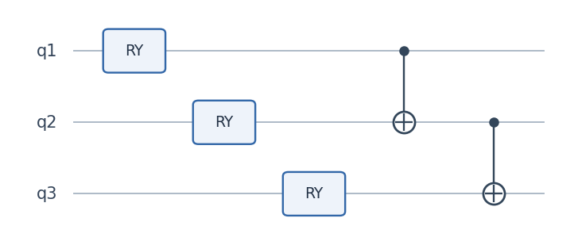
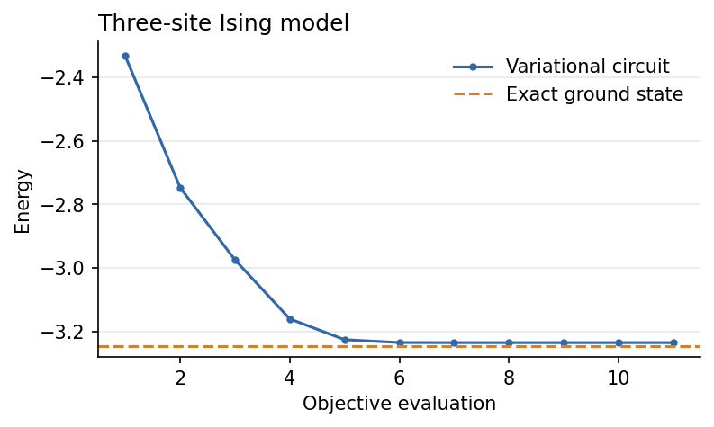
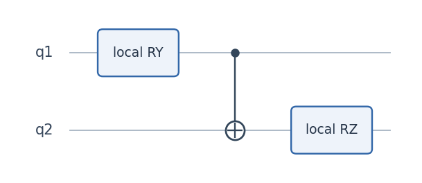
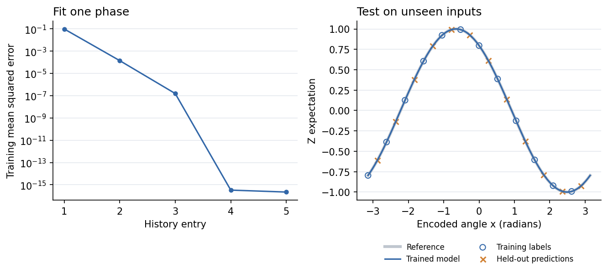
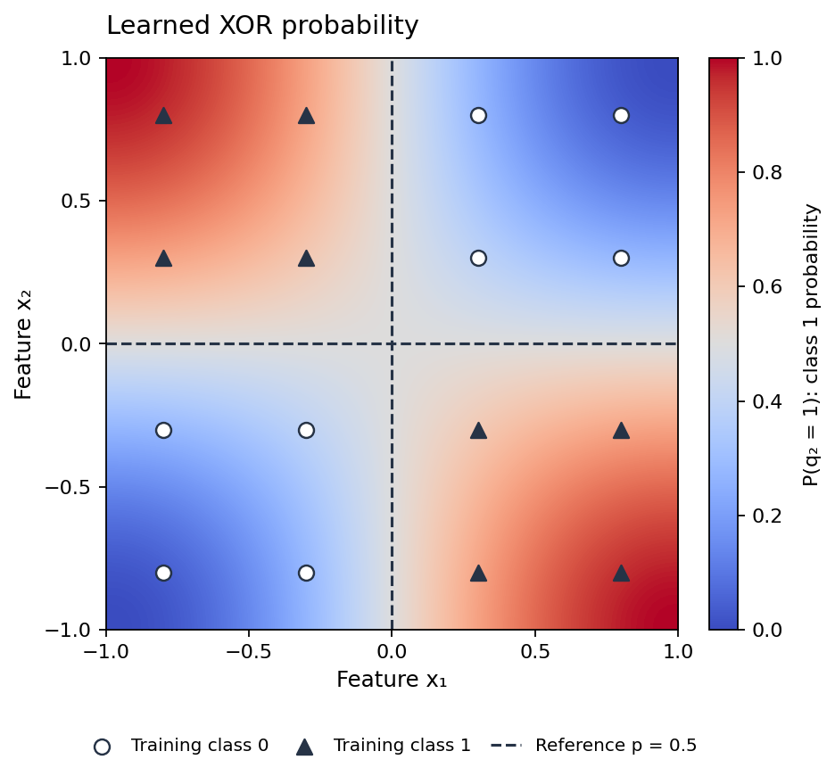

# Quantum Machine Learning

A variational calculation has three pieces: an operation list, a vector of
trainable parameters, and a scalar loss. `variational_apply` evaluates the
circuit; `train` minimizes the loss and always returns the same three fields:
`loss`, `parameters`, and `history`.

This page collects circuit construction, VQE, supervised regression and
classification, gradient checks, noisy training, MPS approximations, and the
QML API. The examples use ordinary functions and arrays, without a separate
machine-learning framework or dataset loader. Statevector and density-matrix
examples use exact expectations; the MPS section makes its truncation explicit.

## Start with a trainable gate

A matrix-valued function makes a gate trainable. A numeric gate string instead
fixes its angle:

```@example qml_gate
using BlueTangle
ops = [Op("RY", _RY, 1)]       # one trainable angle
fixed = [Op("RY(0.3)", 1)]    # a fixed gate
state = variational_apply([0.3], ops)
@assert state ≈ apply(zero_state(1), fixed)
plotq(ops)
nothing # hide
```

Parameters follow operation order; multi-argument gates consume consecutive
entries. Supply one initial value for each trainable angle; fixed gates consume
none. By default the input is `|0…0⟩`; pass `init=state` to evaluate the same
circuit on another input.
Keep trainable gates in this top-level list; named blocks can group fixed
subcircuits, including their noise and measurement operations.

## Minimize the energy of two spins

For the open-chain Hamiltonian `H = -Z₁Z₂ - 0.7(X₁+X₂)`, take two layers of local
Y rotations separated by a CNOT. Define the energy as an ordinary function of
the four angles:

```@example qml_vqe
using BlueTangle, LinearAlgebra
H = hamiltonian(2, [-1.0, "Z,Z", -0.7, "X"])
ops = [Op("RY", _RY, 1), Op("RY", _RY, 2), Op("CX", 1, 2),
       Op("RY", _RY, 1), Op("RY", _RY, 2)]
energy(parameters) = real(expect(variational_apply(parameters, ops), H))
initial = fill(0.3, 4)
result = train(energy, initial; iterations=40)
exact_energy = eigmin(Hermitian(Matrix(H)))
@assert result.loss >= exact_energy - 1e-10
@assert isapprox(result.loss, exact_energy; atol=1e-8)
@assert result.loss ≈ energy(result.parameters)
(initial_energy=energy(initial), trained_energy=result.loss, exact_energy=exact_energy)
```

This small ansatz reaches the exact reference here. That is not guaranteed for
a different Hamiltonian, ansatz, or initial vector. A normalized variational
state must have energy at or above the exact ground-state energy; that exact
diagonalization is feasible only at small system sizes.

`train` defaults to L-BFGS. For example, use `optimizer=:adam`, `iterations=200`,
and `learning_rate=0.05` to request Adam. The returned field names stay the same.
`result.history` stores logged loss values; `result.loss` is the loss evaluated
at the returned parameters. Set `history=false` when the trace is unnecessary.

## Inspect and extend an ansatz

VQE minimizes the energy within a chosen parameterized circuit. A converged
optimizer need not reach the true ground state: the ansatz may be too restricted,
or the optimization may find a local minimum. A small exact diagonalization
provides a useful reference.

```@example vqe
using BlueTangle, LinearAlgebra
N = 3
H = hamiltonian(N, [-1.0, "Z,Z", -0.9, "X"])
exact_energy = eigmin(Hermitian(Matrix(H)))
ops = QuantumOps[Op("RY", _RY, q) for q in 1:N]
append!(ops, [Op("CX", q, q+1) for q in 1:N-1])
energy(parameters) = real(expect(variational_apply(parameters, ops), H))
initial = fill(0.3, N)
result = train(energy, initial; iterations=40)
@assert result.loss >= exact_energy - 1e-10
@assert result.loss <= energy(initial) + 1e-10
(exact=exact_energy, variational=result.loss)
```





`result.parameters` holds the optimized angles and `result.history` the logged
loss values. A remaining energy gap can reflect the circuit's limited
expressiveness or an optimization failure; compare circuit depth and multiple
initializations before deciding which is responsible.

Custom local functions can also define variational gates. Their arguments are
assigned consecutively from the parameter vector:

```@example vqe_custom
using BlueTangle
custom_ops = QuantumOps[Op("local RY", theta -> _RY(theta), 1),
                       Op("CX", 1, 2), Op("local RZ", theta -> _RZ(theta), 2)]
@assert get_N(variational_apply([0.2, 0.4], custom_ops)) == 2
plotq(custom_ops)
nothing # hide
```



Custom gate functions must support the numerical types used by automatic
differentiation. The gradient checks below give a small independent test of
that numerical path.

### Generate repeated layers

For repeated structures, the two generators have distinct conventions:

```@example qml_generators
using BlueTangle
su2 = EfficientSU2(2, 1, ["RY"])
repeated = generate_ansatz_circuit(2, 2, ["RY", "CX"])
initial = fill(0.3, 4) # two RY layers on two qubits
su2_state = variational_apply(initial, su2)
repeated_state = variational_apply(initial, repeated)
nothing # hide
```

`EfficientSU2` makes `reps+1` rotation layers separated by `reps` CX layers;
`generate_ansatz_circuit` repeats the supplied layer list exactly `reps` times.
Both circuits take four angles here, but have different final layers.
`deep_circuit=false` alternates disjoint nearest-neighbor CX bonds instead of
using a full adjacent chain for each entangling layer.

## Fit a function from labeled examples

For a minimal regression task, encode the scalar feature `x` as `RY(x)|0⟩`, then
apply a trainable `RY(theta)` and predict its Z expectation. The two rotations
add, so this model has the exact form

```math
\widehat y(x;\theta)=\cos(x+\theta).
```

Fit the phase from 12 labeled inputs. Reserve 12 interleaved inputs for testing;
they never enter the training loss.

```@example qml_regression
using BlueTangle
ops = [Op("RY", _RY, 1)]
xtrain = collect(range(-pi, pi; length=13))[1:12]
ytrain = cos.(xtrain .+ 0.65)
xtest = xtrain .+ pi/12
ytest = cos.(xtest .+ 0.65)

function predict(parameters, x)
    encoded = _RY(x) * zero_state(1)
    output = variational_apply(parameters, ops; init=encoded)
    return real(expect(output, gate.Z))
end
loss(parameters) = sum((predict(parameters, x)-y)^2
                       for (x,y) in zip(xtrain,ytrain)) / length(xtrain)
initial = [0.2]
@assert loss(initial) ≈ 1-cos(only(initial)-0.65)
fit = train(loss, initial; iterations=30)
predictions = [predict(fit.parameters, x) for x in xtest]
test_mse = sum(abs2, predictions-ytest) / length(ytest)
@assert test_mse < 1e-10
@assert predictions ≈ cos.(xtest .+ only(fit.parameters))
(initial_mse=loss(initial), training_mse=fit.loss,
 heldout_mse=test_mse, fitted_phase=only(fit.parameters))
```

The held-out error checks predictions at unseen inputs, while the analytic
cosine checks the circuit calculation independently. Phases differing by `2pi`
produce the same predictions. This is an exactly
representable, noiseless teaching problem, not evidence of quantum advantage or
accuracy on a realistic dataset. A classical one-parameter cosine fit solves the
same problem. More parameters alone do not establish better generalization.



The left panel shows recorded training losses. The right panel compares the
learned curve, training labels, and held-out predictions. The figure can be
regenerated with `docs/generate_figures.jl` in an environment containing PyPlot;
training itself has no plotting dependency. Losses below machine epsilon share
the plot's display floor.

## Classify two features with a two-qubit circuit

Class 1 means the two feature signs differ, and class 0 means they agree: a
continuous-input XOR problem. Use 16 training points and a separate 400-point
test grid. The grids share no coordinates and exclude the axes, where the class
boundary lies.

```@example qml_classification
using BlueTangle, Statistics
train_levels = [-0.8, -0.3, 0.3, 0.8]
test_levels = collect(range(-0.95, 0.95; length=20))
train_x = [[a,b] for a in train_levels for b in train_levels]
test_x = [[a,b] for a in test_levels for b in test_levels]
label(x) = Int(xor(x[1] > 0, x[2] > 0))
train_y, test_y = label.(train_x), label.(test_x)
@assert isempty(intersect(train_levels, test_levels))

encoding = [Op("RY", _RY, 1), Op("RY", _RY, 2)]
encode(x) = variational_apply((pi/2) .* x, encoding)
train_states, test_states = encode.(train_x), encode.(test_x)
ansatz = [Op("RY", _RY, 1), Op("RY", _RY, 2),
          Op("CX", 1, 2), Op("RY", _RY, 2)]
function probability(parameters, state)
    psi = variational_apply(parameters, ansatz; init=state)
    return abs2(psi[2]) + abs2(psi[4]) # P(q2=1), basis 00,01,10,11
end
```

The encoded states are fixed and prepared once. The circuit has three trainable
angles, and its second-qubit probability is the class-1 score. Minimize binary
cross-entropy, then apply a threshold of 0.5 on the held-out grid:

```@example qml_classification
function loss(parameters)
    mean(eachindex(train_states)) do i
        p = clamp(probability(parameters, train_states[i]), 1e-12, 1-1e-12)
        y = train_y[i]
        -y*log(p) - (1-y)*log1p(-p)
    end
end
initial = [0.2, 0.4, -0.1]
result = train(loss, initial; iterations=80)
train_probabilities = probability.(Ref(result.parameters), train_states)
test_probabilities = probability.(Ref(result.parameters), test_states)
train_accuracy = mean((train_probabilities .>= 0.5) .== train_y)
test_accuracy = mean((test_probabilities .>= 0.5) .== test_y)
test_cross_entropy = mean(-y*log(p)-(1-y)*log1p(-p)
                         for (p,y) in zip(test_probabilities,test_y))
minimum_confidence = minimum(max.(test_probabilities, 1 .- test_probabilities))
@assert test_accuracy >= 0.98
(train_accuracy=train_accuracy, test_accuracy=test_accuracy,
 heldout_cross_entropy=test_cross_entropy, minimum_confidence=minimum_confidence)
```

An independent attainable solution checks the encoding and readout conventions.
At angles `[pi/2, pi/2, 0]`, the pre-CNOT Z expectations are
`-sin(pi*x1/2)` and `-sin(pi*x2/2)`. Conjugating the measured `Z₂` through CNOT
turns it into `Z₁Z₂`, giving

```math
p(x_1,x_2)=\frac{1-\sin(\pi x_1/2)\sin(\pi x_2/2)}{2}.
```

```@example qml_classification
reference(x) = (1-sin(pi*x[1]/2)*sin(pi*x[2]/2))/2
analytic_parameters = [pi/2, pi/2, 0.0]
@assert all(isapprox(probability(analytic_parameters, encode(x)), reference(x);
                     atol=1e-12) for x in test_x)
```

The dashed axes mark the analytic `p=0.5` reference boundary; the colors show
the trained probabilities.



For the displayed run, both accuracies are 100%, but held-out cross-entropy is
about 0.3735 and the least confident correct prediction has probability only
0.5031. Perfect threshold accuracy is not high confidence: finite-shot readout
near the axes can flip the predicted label. This is a small supervised-learning
example, not a quantum-advantage result; the classical rule `x1*x2 < 0` solves
the same classification task exactly.

## Choose and check a gradient

| Setting | Suitable calculation |
|:--|:--|
| `gradient=:forward` (default) | Differentiable statevector or deterministic density-matrix loss |
| `gradient=:finite_difference` | Deterministic calculations that cannot use automatic differentiation, including truncated MPS |
| `gradient=p -> gradient_vector` | An analytic or independently implemented gradient of the complete scalar loss |

Finite differences need roughly two shifted evaluations per parameter, and
their step size must resolve the loss without amplifying numerical error.
Neither finite differences nor automatic differentiation turn sampled noise into
a deterministic gradient. Use density evolution for an exact noisy ensemble,
or define and validate an explicit stochastic gradient estimator.

This small check uses a **nonlinear** loss, `loss(theta)=⟨Z⟩²=cos(theta)²`.
Its derivative is `-sin(2theta)`. Compare automatic differentiation with centered
finite differences and this independent analytic answer:

```@example qml_gradient
using BlueTangle, ForwardDiff
ops = [Op("RY", _RY, 1)]
loss(parameters) = real(expect(variational_apply(parameters, ops), gate.Z))^2
parameters = [0.37]
h = 1e-5
automatic = ForwardDiff.gradient(loss, parameters)
finite_difference = [(loss(parameters .+ h)-loss(parameters .- h))/(2h)]
analytic = [-sin(2only(parameters))]
@assert isapprox(automatic, finite_difference; atol=1e-8)
@assert automatic ≈ analytic
(automatic=automatic, finite_difference=finite_difference, analytic=analytic)
```

For an expectation `z(theta)`, a gate's parameter-shift rule differentiates
`z`; a nonlinear loss such as `z²` still needs the chain rule `2z*dz/dtheta`.
Shifting the entire nonlinear loss with the expectation-value rule is generally
wrong. If supplying a parameter-shift gradient through `train`'s `gradient`
callback, differentiate the complete loss and check that the gate's shift rule
applies. Parameter-dependent MPS truncation can invalidate that rule.

## Train with deterministic noise

For differentiable noisy simulation, use a density matrix to sum Kraus branches:

```@example qml_noise
using BlueTangle, LinearAlgebra
ops = [Op("RY", _RY, 1)]
rho0 = zero_state(1) * zero_state(1)'
noise = NoiseModel(Noise1("bit_flip", 0.02), false)
noisy_energy(parameters) = real(expect(
    variational_apply(parameters, ops; init=rho0, noise=noise), gate.Z))
rho = variational_apply([0.3], ops; init=rho0, noise=noise)
@assert isapprox(real(tr(rho)), 1; atol=1e-12)
@assert noisy_energy([0.3]) ≈ (1-2*0.02)*cos(0.3)
noisy_fit = train(noisy_energy, [0.3]; iterations=30)
@assert isapprox(noisy_fit.loss, -(1-2*0.02); atol=1e-8)
noisy_fit.loss
```

A statevector with stochastic noise or selective measurements samples a
trajectory, so it does not define the same deterministic differentiable loss.
Finite-shot training needs an explicit estimator and sampling-error treatment.

## Train an MPS and check truncation bias

MPS decompositions are not supported by ForwardDiff. Use finite differences for
a deterministic MPS loss and check the approximation itself. This deliberately
severe example caps the bond dimension at 1, discarding entanglement created by
a fixed rotation and CNOT before training a final rotation.

```@example qml_mps
using BlueTangle
ops = [Op("RY(0.8)", 1), Op("CX", 1, 2), Op("RY", _RY, 1)]
initial_state = zero_state(N_MPS(2))
function mps_energy(parameters; maxdim=1)
    state = variational_apply(parameters, ops; init=initial_state,
                              cutoff=0.0, maxdim=maxdim)
    return expect(state, "Z")[1]
end
fit = train(p -> mps_energy(p), [0.3]; gradient=:finite_difference, iterations=30)
untruncated = mps_energy(fit.parameters; maxdim=2)
dense_reference = expect(variational_apply(fit.parameters, ops), "Z")[1]
@assert isapprox(fit.loss, -1; atol=1e-8)
@assert untruncated ≈ dense_reference ≈ -cos(0.8)
(truncated_loss=fit.loss, untruncated_loss=untruncated, dense_reference=dense_reference)
```

The truncated loss reaches `-1`, while the original circuit evaluated at the
same trained parameters gives about `-0.6967`. The optimizer solved the supplied
approximate problem; it did not validate the untruncated circuit. Here `maxdim=2`
retains the full two-qubit Schmidt rank and matches the dense reference. In a
larger calculation, increase the bond cap, tighten the cutoff, and check the
finite-difference estimate until the observables of interest converge.

## Keep training efficient

Construct the operation list once and precompute fixed feature states, as the
classifier does. Use `history=false` when loss traces are unnecessary. Local
statevector gates act on amplitudes directly, avoiding full-register matrices,
but the state itself still grows as `2^N`; density-matrix memory grows as `4^N`.
MPS can reduce that cost when modest bond dimensions suffice, but verify
`cutoff`/`maxdim` convergence rather than assuming it. The repository's
[benchmark/qml.jl](https://github.com/aydindeger/BlueTangle.jl/blob/main/benchmark/qml.jl)
compares the training paths on a specified workload; timings depend on the
circuit, hardware, and compilation state.

## API reference

```@docs
variational_apply
train
EfficientSU2
generate_ansatz_circuit
```
